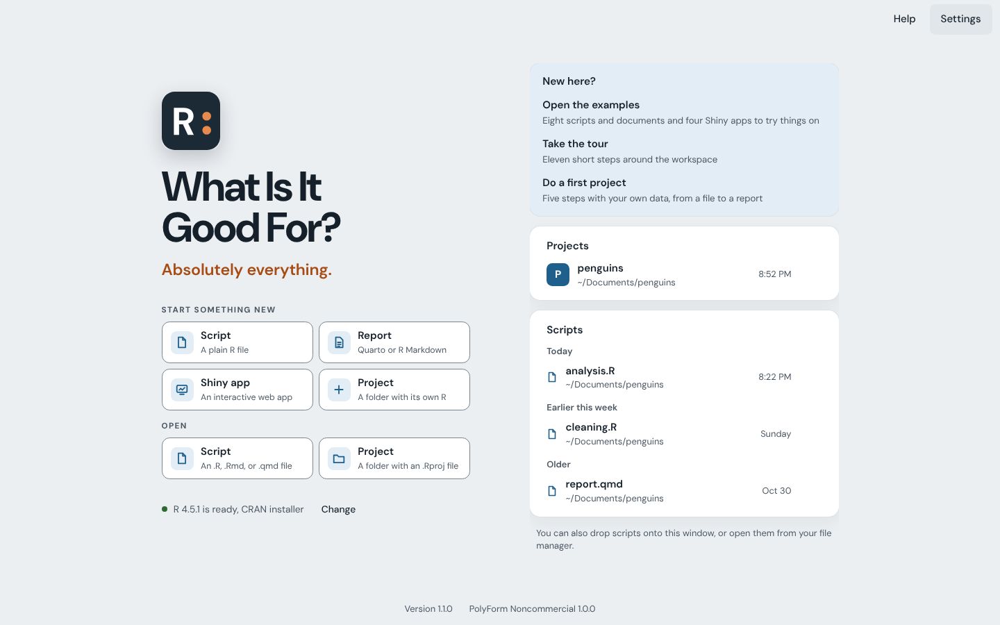
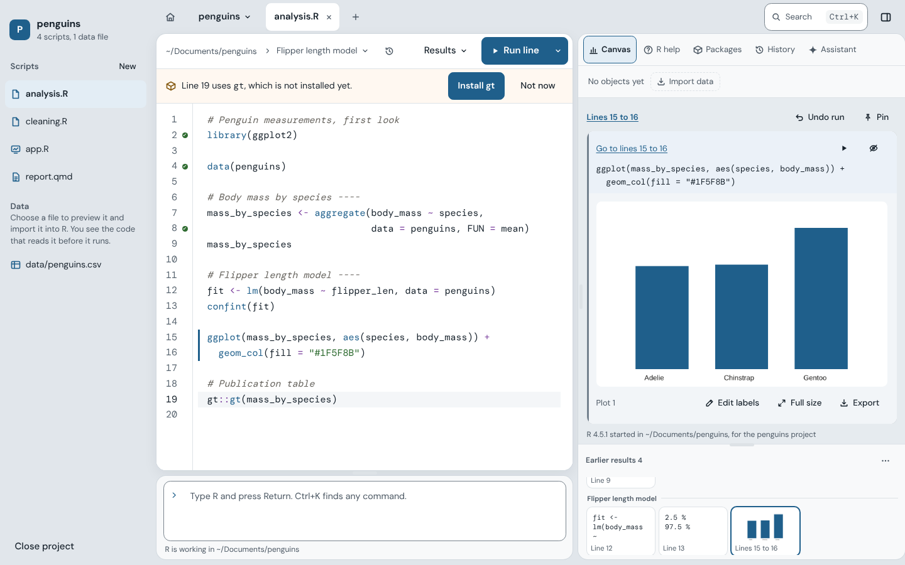
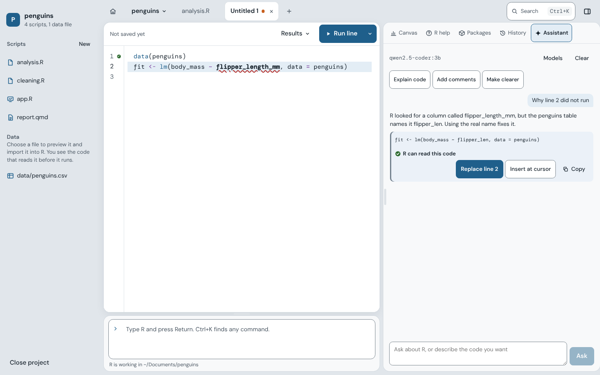

# R: What Is It Good For?

[](LICENSE.md)
[](#requirements)


[](https://github.com/drabhikroy/goodR/releases)

R: What Is It Good For? is a desktop application for writing and running R, the programming language used for statistics and data analysis. It is an integrated development environment, or IDE: one window for writing code, running it, and reading the result. Results appear next to the code that made them, and a failed line is explained in plain words instead of a bare error message. It suits a first script as well as a daily one, whether you are learning R, teaching it, or using it for research.

The app runs on macOS. Linux and Windows versions are available as a preview: they are built and tested by machine, and are waiting on reports from people using them on a real desktop.

Everything runs on your computer. No account is needed, and the app collects no data about you or your work.

<picture>
  <source media="(prefers-color-scheme: dark)" srcset="docs/images/opening-dark.png">
  
</picture>

## What it does

Your script is on the left side of the window and your results are on the right. Run a line and its result appears beside it. Click a result later and the app takes you back to the line that made it.

<picture>
  <source media="(prefers-color-scheme: dark)" srcset="docs/images/workspace-dark.png">
  
</picture>

### Writing and running R

- **Results beside the code.** Run a line, a section, or a whole script. Each plot, table, or printout lands on the canvas. Earlier results stay in a strip underneath so you can go back to them.
- **Errors explained in plain words.** A failed line is explained in everyday language and marked in your script. R's own message is one click away. Common problems come with a button that fixes them.
- **Outdated code brought up to date.** Fix problems finds functions and arguments that packages have retired and updates them in one step.
- **Questions ready to post.** Ask for help online writes up a question for a forum. It includes the code that led to the error, a small sample of the data, and your versions.
- **A data viewer that writes code.** Each column shows its type, a small chart, and its missing values. When you filter or rename in the viewer, the matching line of R is added to your script.
- **Statistics explained in words.** Tests and models come with a sentence in APA style and a check of their assumptions.

### Reports and Shiny apps

- **Reports.** R Markdown and Quarto documents render to HTML, Word, and PDF beside the code. The preview can update every time you save.
- **Shiny apps.** An app runs next to its code. A map shows how its inputs and outputs connect. Likely mistakes are flagged before the app runs. An app can also be shared as a web page.

### Keeping track of your work

- **One R for each project.** Objects from one project never turn up in another.
- **Mistakes are easy to undo.** Undo the last run. Get unsaved work back after a crash. Compare a script with any of its earlier versions.
- **Every result traces back to its code.** Trace any object back through the lines that made it.

### Learning and teaching

- **Teaching tools.** Turn a script into exercises that check each answer.
- **Learning built in.** A short tour, examples built on real data, and a guided first project that goes from a data file to a report.

### Making it yours

- **Your own look.** Light, dark, and paper themes. Palettes for different kinds of color vision. Sixteen code fonts. Any part of the window can be hidden.
- **Updates in one place.** One page lists updates for the app, R, your packages, Ollama, and assistant models.

The [feature guide](docs/FEATURES.md) describes every feature in detail with screenshots.

## What it does not do

The app is not a version of RStudio or Positron. It does not read their settings.

It does not run your code on a server. R runs on your computer.

It does not open your data files itself. R reads them when your code runs. The app opens only the scripts you choose and the scripts in their projects.

It does not install R. It finds the R you already have.

It never changes your files on its own. Saving, installing, and running happen only when you ask. The one exception is Save files automatically, which you can turn on in Settings.

## Requirements

- **macOS:** macOS 12 Monterey or later, on an Apple silicon or Intel Mac
- **Linux (preview):** a 64-bit Intel, AMD, or ARM computer running Ubuntu 22.04, Debian 12, or a newer release of either, or another current distribution
- **Windows (preview):** Windows 10 or 11 on a 64-bit Intel or AMD computer
- **R:** version 4.2 or later, on every system

The app uses the R already on your computer. If you do not have R yet, install it before the app. CRAN, the official download site, has R for each system.

- **macOS.** Open [R for macOS](https://cran.r-project.org/bin/macosx/). Download the installer for your Mac, arm64 for Apple silicon or x86_64 for Intel, then open it and follow the steps. To check which Mac you have, choose About This Mac from the Apple menu. A chip name that starts with Apple means Apple silicon.
- **Linux.** Follow the steps for your distribution under [R for Linux](https://cran.r-project.org/bin/linux/). Ubuntu 22.04's own `r-base` package is R 4.1, which is too old, so on Ubuntu use CRAN's repository as those steps describe.
- **Windows.** Open [R for Windows](https://cran.r-project.org/bin/windows/base/), download the installer, and open it. The usual choices are fine.

Some features need a little more. The app tells you when something is missing.

| To | You also need |
| --- | --- |
| Render R Markdown | The rmarkdown and knitr packages, which the app installs with one click |
| Render Quarto documents | [Quarto](https://quarto.org/docs/get-started/) |
| Make PDFs | LaTeX or Quarto. The app can install a small LaTeX for you |
| Run Shiny apps | The shiny package, which the app offers to install |
| Use the assistant | [Ollama](https://ollama.com/download). On a Mac the app can install and run it for you |

## Install

Every installer is on the [latest release](https://github.com/drabhikroy/goodR/releases/latest) page. When goodR first opens it finds R and starts it. If there is more than one version of R, it asks which one to use. Quit goodR before installing a newer version over an older one.

### macOS

1. Download `goodR-1.1.0.pkg`.
2. Open it and follow the steps. macOS asks for an administrator password because the installer puts the app in your Applications folder.
3. Open goodR from the Applications folder.

The installer is signed and notarized by Apple, so macOS opens it without a warning.

### Linux (preview)

Each Linux installer comes in two kinds, one for Intel and AMD processors and one for ARM processors. To see which you have, run `dpkg --print-architecture` or `uname -m`. A result of `amd64` or `x86_64` means Intel or AMD, and `arm64` or `aarch64` means ARM. A Linux virtual machine on an Apple silicon Mac is ARM.

On Ubuntu, Debian, and other systems that use `.deb` packages, download `goodR-1.1.0-amd64.deb` for Intel or AMD, or `goodR-1.1.0-arm64.deb` for ARM, and install it with this command, run in the folder you downloaded it to. The example is for Intel or AMD.

```bash
sudo apt install ./goodR-1.1.0-amd64.deb
```

On any other distribution, download `goodR-1.1.0-x86_64.AppImage` for Intel or AMD, or `goodR-1.1.0-aarch64.AppImage` for ARM, make it runnable, and open it. The example is for Intel or AMD.

```bash
chmod +x goodR-1.1.0-x86_64.AppImage
./goodR-1.1.0-x86_64.AppImage
```

goodR draws its window without the graphics card's help on Linux, because with it the window comes up blank in virtual machines and with some drivers. On a computer where the card works well, start goodR with `GOODR_GPU=1` to turn the card's help back on.

If the AppImage does not open, your system may need FUSE 2, which AppImages use. On Ubuntu 24.04 it installs with `sudo apt install libfuse2t64`, and other distributions name the package `fuse2` or `fuse-libs`.

### Windows (preview)

1. Download `goodR-1.1.0-x64-setup.exe` and open it.
2. The installer is not yet signed, so Windows shows "Windows protected your PC" the first time. Choose More info, then Run anyway.
3. Follow the steps. It installs for your account alone, so it needs no administrator password, and it adds goodR to the Start menu.

### Checking the download

Each release lists a checksum for every installer: `SHA256SUMS.txt` for the Mac, `SHA256SUMS-linux-x64.txt` or `SHA256SUMS-linux-arm64.txt` for Linux, and `SHA256SUMS-windows.txt` for Windows. Put the file in the same folder as the installer and run the command for your system. On macOS and Linux it should report `OK`, and on Windows it should print `True`.

```bash
# macOS
shasum -a 256 -c SHA256SUMS.txt
# Linux
sha256sum -c --ignore-missing SHA256SUMS-linux-x64.txt
```

```powershell
# Windows, in PowerShell
(Get-FileHash goodR-1.1.0-x64-setup.exe).Hash -eq (Get-Content SHA256SUMS-windows.txt).Split(" ")[0]
```

### Removing the app

Quit goodR first. Your scripts and reports stay where you saved them either way.

- **macOS.** Move goodR from the Applications folder to the Trash.
- **Linux.** For the `.deb`, run `sudo apt remove good-r`. For the AppImage, delete the file.
- **Windows.** Open Settings, then Apps, then Installed apps, and choose Uninstall beside goodR.

To also remove the app's settings and saved versions, delete its folders, listed under [Your data](#your-data).

## Using the app

1. Open goodR. Start a new script, open one you already have, or choose **Open the examples**.
2. Put the cursor on a line of code and press Command Return on a Mac, or Ctrl Enter on Linux and Windows.
3. The result appears on the right. Keep going line by line, or press Shift Command Return, or Ctrl Shift Enter, to run the whole file.

New to the app? Choose **Take the tour** on the opening screen. It shows each part of the window in a couple of minutes.

Help is under the Help menu, or Shift Command / on a Mac and Ctrl Shift / elsewhere. It has a search box and answers to common questions. Each topic can point to the part of the window it describes. The keyboard shortcuts are listed in the [feature guide](docs/FEATURES.md#keyboard-shortcuts-and-sessions).

## Your data

Your code and data stay on your computer. The app sends no usage data and no crash reports. The only connections it makes on its own are update checks. They ask GitHub, CRAN, and Ollama for version numbers and nothing else. You can set them to happen only when you ask.

The app keeps its own files in a folder named `app.goodfor.ide`, and where that folder is depends on the system.

- **macOS:** `~/Library/Application Support/app.goodfor.ide`
- **Linux:** `~/.config/app.goodfor.ide` for settings and earlier versions, and `~/.local/share/app.goodfor.ide` for the assistant and LaTeX
- **Windows:** `%APPDATA%\app.goodfor.ide`

| What the app keeps | Where, inside that folder | How long it stays |
| --- | --- | --- |
| Settings and recent files | `settings.json` | Until you reset the app or delete the file |
| Earlier versions of each script | `history` | The latest 100 versions of each script |
| Unsaved changes | The app's private storage | Until the file is saved or closed |
| Recent results | The app's private storage | The latest 60, until you clear them |
| The assistant's own copy of Ollama, on a Mac, and its models | `assistant` | Until you remove them from the assistant's setup |
| The app's own LaTeX, if you install it | `TinyTeX` | Until you delete the folder |

[Your files and your privacy](docs/PRIVACY.md) explains which files the app may open and what the assistant can see. See [The assistant](#the-assistant) below for what it can see once it is set up.

## The assistant

An optional assistant explains errors and code, and can draft R from a plain description of what you want. It runs entirely on your computer through [Ollama](https://ollama.com), free software that runs language models locally, so nothing you ask it is sent anywhere.

Setting it up takes three steps. Choose the Ollama already on your computer, or on a Mac let the app install and verify a private copy of its own. Optionally let the app check your computer's memory and free disk space, so it can say which models will fit. Then choose a code model from a short list, each one showing what it is good and less good at. The app suggests the one that fits your Mac best, and you can add, remove, or switch models at any time.

The assistant sees the code you ask about, R's error message, your R version, and the names of your objects and columns. It never sees the values in your data.

<picture>
  <source media="(prefers-color-scheme: dark)" srcset="docs/images/assistant-dark.png">
  
</picture>

## Accessibility

- **Standard.** The app is built to meet WCAG 2.2 at the AA level. Every screen is checked with automated tests in every theme.
- **Keyboard.** Everything can be done from the keyboard. Every control shows where focus is.
- **Screen readers.** Buttons and controls have names. Results and errors are announced as they happen without moving focus.
- **More than color.** Each state has its own icon and words as well as its own color.
- **Color vision.** Five palettes cover standard vision, deuteranopia, protanopia, tritanopia, and monochrome.
- **Size and motion.** Text scales from 90 to 150 percent. Animation stops when the system is set to reduce motion.

Automated tests cannot catch everything. If something gets in your way, please [open an issue](https://github.com/drabhikroy/goodR/issues). The full list is in [Accessibility](docs/ACCESSIBILITY.md).

## How it works

R runs through [ark](https://github.com/posit-dev/ark), the R kernel from Posit Software, in the background. Each project gets its own R process, so objects from one project never reach another, and a script that belongs to no project gets a small R of its own, started in its own folder.

Running a line sends it to that R and keeps a link between the line and its result, so clicking a result later returns you to the line that made it. Errors are parsed rather than shown as raw text, so the app can point to the exact spot in your script and explain what the message means.

[The design notes](docs/DESIGN.md) cover the reasoning behind these choices, and the research behind that reasoning, in full.

## Help and feedback

To report a problem or suggest an idea, [open an issue](https://github.com/drabhikroy/goodR/issues). To report a security problem privately, see the [security policy](SECURITY.md).

## For developers

[Developing goodR](docs/DEVELOPING.md) covers building from source, the tests, how the app works inside, and how releases are signed. [CONTRIBUTING.md](CONTRIBUTING.md) has the conventions and checks. Please also read the [code of conduct](CODE_OF_CONDUCT.md).

## Credits and background

The name comes from the question many people ask when they first meet R. It is also a nod to the song. The answer on the opening screen is "Absolutely everything."

R runs inside the app through [ark](https://github.com/posit-dev/ark) by Posit Software, PBC. It is used under the MIT License and its license and notice ship with the app. The interface uses the DM Sans and DM Mono typefaces under the SIL Open Font License.

## License

[PolyForm Noncommercial License 1.0.0](LICENSE.md). The full text is also at <https://polyformproject.org/licenses/noncommercial/1.0.0>.

Personal use, personal study, hobby projects, teaching, academic research, and use by charitable, educational, nonprofit, public research, public health, and government organizations are permitted. Commercial use is not permitted without a separate license.

Required notice: © 2026 Abhik Roy.
