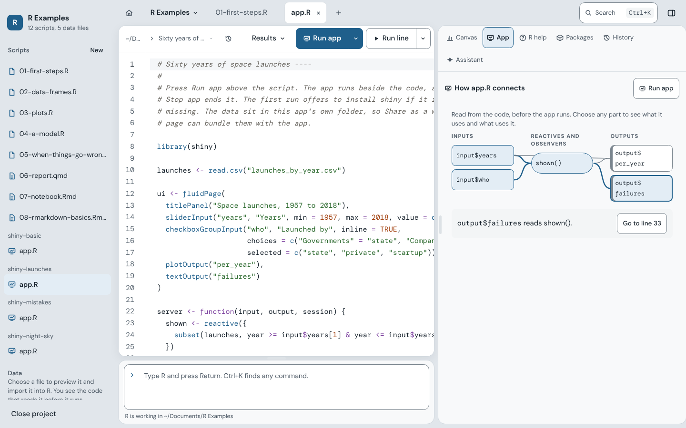

# R: What Is It Good For?

[](LICENSE.md)
[](#requirements)


[](https://github.com/drabhikroy/goodR/releases)

R: What Is It Good For? is a desktop app for writing R on a Mac. You write your script on the left. When you run a line, its plot, table, or printed result shows up on a canvas on the right, and clicking a result takes you back to the line that made it. It is made for people who are new to R, and it works just as well for people who use R every day. Windows and Linux versions will follow.

The opening screen answers the question in the name: absolutely everything. You can clean your data, run an analysis, write it up as a report, and build a Shiny app without leaving the app.

<picture>
  <source media="(prefers-color-scheme: dark)" srcset="docs/images/opening-dark.png">
  
</picture>

## What it does

You can run R a line, a section, or a whole file at a time. Each result lands on the canvas and stays linked to its line. Older results move to a strip under the canvas, where you can click one to jump back to its code, or pin one to compare it with what comes next.

When a line fails, the app explains the error in plain English and marks the spot in your script. If the fix is obvious, such as installing a missing package, a button does it. Fix problems finds code that a package has retired and updates it. Ask for help online writes up a question you can post to a forum, with the lines that led to the error, a small sample of your data, and your versions.

R Markdown, Quarto, and Shiny all run beside the code. Each project gets its own R, so objects from one project never turn up in another.

There are a few things to fall back on when work goes wrong. You can undo the last run. Unsaved work comes back after a crash. Every script keeps earlier versions, and you can see what changed between them.

For research and teaching, the app can write up statistical results in APA style with their assumptions checked, trace an object back through the script with Where did this come from?, and turn a script into exercises that check students' answers.

The rest:

- An optional assistant that runs on your own Mac through Ollama
- Any part of the window can be hidden
- Sixteen code fonts; light, dark, and paper themes; and palettes for color vision differences
- One page in Settings for updating the app, R, packages, Ollama, and assistant models

Every feature, and how it behaves, is described in [the feature guide](docs/FEATURES.md).

## A look around

When you run code, the result shows up on the canvas next to the line that made it.

<picture>
  <source media="(prefers-color-scheme: dark)" srcset="docs/images/workspace-dark.png">
  
</picture>

The data viewer summarizes each column. Changes you make there, such as keeping only some rows, are written into your script as R.

<picture>
  <source media="(prefers-color-scheme: dark)" srcset="docs/images/data-viewer-dark.png">
  
</picture>

Reports render next to the code, and can render again each time you save.

<picture>
  <source media="(prefers-color-scheme: dark)" srcset="docs/images/report-dark.png">
  
</picture>

A Shiny app runs next to its code, and the app maps how its inputs, reactives, and outputs connect.

<picture>
  <source media="(prefers-color-scheme: dark)" srcset="docs/images/shiny-dark.png">
  
</picture>

Help has a short tour, worked examples, and a guided first project.

<picture>
  <source media="(prefers-color-scheme: dark)" srcset="docs/images/help-dark.png">
  
</picture>

There are more screenshots in [the feature guide](docs/FEATURES.md).

## What it does not do

It is not a fork of RStudio or Positron, and it does not read their settings.

Your code never runs on a server. R runs on your own computer.

The app does not open your data files itself. It lists them by name, and R reads them when you run the code that loads them. It also does not open any file except the scripts you choose and the scripts in their projects.

It does not collect usage data or send crash reports.

It does not install R for you. It finds the R you already have, and if there is none, it points you to CRAN.

It never changes your files on its own. Saving, installing, and running only happen when you ask, unless you turn on Save files automatically.

## Planned

These are designed and should arrive in later releases, roughly in this order:

1. Publishing a shared Shiny app's web page in one step, to a host you choose
2. A Git panel for history, committing, and pushing
3. Background jobs, with progress, for long scripts
4. Results in a separate window, for a second display
5. Windows and Linux releases. The code already builds and runs on Linux, and the tests run there on every change.

## Requirements

- macOS 12 Monterey or later, on Apple Silicon or Intel
- R 4.2 or later, from [CRAN](https://cran.r-project.org/) or Homebrew

R 4.2 is the oldest version that ark, the R kernel inside the app, supports. If your R is older, the app tells you so and does not try to start it.

That is all you need to write and run R. Some features need a little more, and the app tells you what is missing the first time you use them.

Reports need the rmarkdown and knitr packages, which the app can install with one button. Quarto documents also need [Quarto](https://quarto.org/docs/get-started/). R Markdown documents can render to HTML and Word without Quarto, as long as Pandoc is installed (Quarto comes with its own Pandoc).

PDFs need one of these:

- A LaTeX you already have, such as MacTeX, TeX Live, MiKTeX, or TinyTeX
- The app's own TinyTeX, which you can install with one press from Settings, under Reports, or when a PDF asks for it
- Quarto on its own, which can make PDFs with Typst instead of LaTeX

Shiny apps need the shiny package. The App sheet offers to install it the first time you run an app without it. To share an app as a web page you also need the shinylive package, which the Share dialog offers to install, and an internet connection the first time, when shinylive downloads its web files.

## Install

1. Download [goodR.dmg](https://github.com/drabhikroy/goodR/releases/latest/download/goodR.dmg). The same file works on Apple Silicon and Intel Macs.
2. Open the downloaded file.
3. Drag goodR into the Applications folder.
4. Open goodR from Applications.

Each release lists a SHA-256 checksum next to the disk image. To check your download against it, run this in Terminal and compare the result:

```bash
shasum -a 256 ~/Downloads/goodR.dmg
```

## Using the app

R starts when the app opens. The opening screen lets you start a new project, open a project, or start or open a script, and it lists the projects and scripts you used recently. You can also drop scripts on the window, or use Open With in Finder. The app shows up there for R, R Markdown, and Quarto files, but it does not make itself the default app for them.

These are the main keyboard shortcuts:

| To | Press |
| --- | --- |
| Start a new project | ⇧⌘N |
| Open a project | ⇧⌘O |
| Open a script | ⌘O |
| Start a new script | ⌘N |
| Save, or Save As | ⌘S, ⇧⌘S |
| Run the line or selection | ⌘↩ |
| Run the chunk, or a script's section | ⌥⌘C |
| Run the whole file | ⇧⌘↩ |
| Start a new Quarto or R Markdown document | ⌥⌘N |
| Insert a chunk | ⌥⌘I |
| Render the report | ⇧⌘K |
| Run a Shiny app | Run app in the title bar, or Run, Run Shiny App |
| Stop | ⌘. |
| Restart R | ⇧⌘0 |
| Export the plot on show | ⇧⌘E |
| Explain the code at the cursor with the assistant | ⌥⌘E |
| Show the assistant | ⌃9 |
| Insert a pipe, an assignment, or a section | ⇧⌘M, ⌥−, ⇧⌘R |
| R help for the name at the cursor | F1 |
| Show R help, history, or packages over the canvas | ⌃3, ⌃4, ⌃7 |
| Move to the canvas, or to the objects in R | ⌃6, ⌃8 |
| Search for any command, or look a function up in R help | ⌘K |
| Help for this app | ⇧⌘/ |
| Show results in the canvas, or under each line | ⌥⌘1, ⌥⌘2 |
| Update results as you type, on or off | ⌥⌘L |
| Show or hide the project sidebar | ⌃⌘S |
| Show or hide the canvas | ⌥⌘0 |
| Show past commands | ⇧⌘Y |
| Show the start screen, without closing anything | ⇧⌘H |
| Move to the editor or the R prompt | ⌃1, ⌃2 |

On Windows and Linux, Ctrl replaces ⌘ and Alt replaces ⌥, and the app shows them that way. The sidebar shortcut there is Ctrl B.

A project's R works in the project's folder. Opening a project leaves your other work open, each in its own R. Closing a project ends its R, and closing a script that is not part of a project ends that script's R. A new untitled script uses the R of whatever tab is in front, or, if nothing is open, an R kept for untitled work.

Restart R, in the Run menu, restarts only the R of the script in front. Choosing a different R version, from Settings under R and packages or from the Run menu, restarts every session with that version. The menu at the top left switches between open projects and scripts.

To make the canvas wider or narrower, drag its left edge, or focus it and press the left and right arrow keys.

Settings is split into Appearance, Layout, Code text, Editor, Results, Reports, Accessibility, R and packages, Updates, and Menus. Changes apply right away, so there is nothing to save.

When you type three characters of a name, or press Tab, R suggests completions. Tab or Return picks the highlighted one.

## Your data

The app only reads and writes scripts, meaning R, R Markdown, and Quarto files. It can open a script once you have chosen it in the Open or Save dialog, dropped it on the window, opened it from Finder, or picked it from the recent list. Opening a project, or a script inside one, also lets it open the other scripts in that project's folder, and nothing else.

To work out which project a script belongs to, the app looks at the folders above the script, stopping before your home folder, and checks only the file names for a `.Rproj` file. It does not read any file contents along the way.

The app never opens data files, whether they are listed in a project or chosen in Import Data. R reads them, for the preview and when the import code runs.

Help pages come from R itself. The app rebuilds them from a short list of allowed tags, so a help page cannot run code or reach the network.

The list of files the app may open is kept in the app's own core, not in the interface, and the interface cannot add to it. A file you never chose stays out of reach. The Open, Save, and project folder dialogs run in that same core.

Settings, the lists of recent scripts and projects, and what to reopen at launch are kept in one file, `~/Library/Application Support/app.goodfor.ide/settings.json`. If that file gets damaged, the app sets it aside under a new name instead of deleting it.

As you type, unsaved changes are copied to the app's own storage on your computer so a crash cannot lose them. Each copy is deleted once its file is saved or closed. For Undo, R keeps references to your objects as they were before the last run, in memory only, until the next run. Timing a run writes R's samples to a temporary file, which R deletes when it quits.

The data viewer asks R for one page of rows at a time and keeps nothing once you close the tab. Exporting a plot reruns the code that made it in a scratch environment, so nothing it assigns ends up in your workspace, and it puts the random number state back afterward.

R itself can read and write anywhere your user account can, just as it does in Terminal or any other R environment. The app does not limit what your code does.

## The assistant

The assistant is optional. It stays off until you set it up from its button on the canvas, next to R help, Packages, and History. It runs through [Ollama](https://ollama.com), a free program that runs language models on your own computer.

Setting it up takes three steps.

1. Ollama. You can use the Ollama already on your Mac, or install a private copy inside the app. The private copy is Ollama 0.40.3, a 167 MB download. The app checks it against Ollama's published SHA-256 before unpacking it. It lives in `~/Library/Application Support/app.goodfor.ide/assistant`, runs only while the app is open, uses a port of its own, and can be removed, along with its models, from the same screen.
2. This Mac. If you agree, the app reads your Mac's memory, free disk space, and chip, so it can mark which models will fit. You can skip this step. Nothing is saved or sent.
3. Models. You choose from a short list of free code models: Qwen2.5 Coder in three sizes, and Qwen3 Coder. Each one says what it does well and less well when helping with R, how much it downloads, and whether it fits your Mac. The app suggests the largest one that fits comfortably. Models you already downloaded with Ollama are found and can be used, and you can add, remove, or switch models at any time.

<picture>
  <source media="(prefers-color-scheme: dark)" srcset="docs/images/assistant-setup-dark.png">
  
</picture>

<picture>
  <source media="(prefers-color-scheme: dark)" srcset="docs/images/assistant-dark.png">
  
</picture>

The assistant sees the code you ask about, R's error message, your R version, and the names of the objects in your session, including column names for tables. It never sees the values in your data.

Whatever it writes is a suggestion. Code only goes into your script when you press Insert or Replace. R's parser checks the code first without running it, and Undo takes it back out. Replace only appears when the suggestion is a reworked version of the code you asked about, so it can never wipe out your code with an unrelated step. If a suggestion only installs packages, you get Put in the Console instead, which places it at the R prompt. An install is a one-time step and does not belong in your script.

## Accessibility

There are five color vision palettes: standard, deuteranopia, protanopia, tritanopia, and monochrome. Each one comes in Light, Dark, and Paper. An automated audit runs more than 2,000 contrast checks against WCAG 2.2 AA, and also checks that states such as warning and error can still be told apart under simulated color vision deficiency. A palette changes the colors of the whole window, including buttons, links, focus rings, selections, status, code, and plots.

Color is never the only signal. Each state also has its own icon shape and words, such as a triangle and "did not run".

Other things that help:

- Appearance can follow the system, or be set to light or dark.
- Text can be sized from 90 to 150 percent, which scales the whole interface, controls included. Code has its own size, from 11 to 24 points.
- Every pointer target is at least 44 pixels tall, and a test checks this on every screen.
- Animation stops when the system asks for reduced motion, or when you turn on Reduce motion in Settings.
- Every control shows focus. Dialogs keep focus inside them while open and hand it back when they close. Menus move with the arrow keys and close with Escape. Everything can be done from the keyboard, through shortcuts and the command palette.
- Controls are labeled with words, not just icons, and every menu item shows its keyboard shortcut.
- Run results and status changes are announced to screen readers without moving focus, including what went wrong when a line fails. An assistant answer is announced once it is finished, not word by word.
- Controls have names and roles for screen readers, and every screen passes automated WCAG 2.2 A and AA checks with axe, in every appearance.

Automated checks catch a lot, but not everything. Reports from people who use VoiceOver or other assistive technology are especially welcome.

## How it works

The app is built with [Tauri](https://tauri.app/). A small Rust core owns the
window, the files, and R. The interface is React and TypeScript shown by
the system's own web view, WebKit on the Mac, so the app stays small and
starts quickly. The editor is CodeMirror 6.

The Open and Save dialogs run in the Rust core rather than the interface,
so the paths they return are known to come from you. The core keeps the set
of files you chose, plus the open project's folder for scripts only, and
checks every read and write against it. A new project can only be created
in the folder you just chose in its dialog.

R runs in [ark](https://github.com/posit-dev/ark), the R kernel Posit wrote
for Positron, as a separate process. The Rust core speaks the Jupyter
protocol to it over ZeroMQ on loopback ports, with every message signed by a
key generated for that session. Each run carries an id chosen by the
interface before it is sent, so output can never arrive for a run the
interface does not yet know about. Runs are queued and go one at a time, so
output arrives in order and Run File stops at the first error, as sourcing
a script does.

A few helper functions written in base R are attached to the session as
`tools:goodfor`, the way RStudio attaches `tools:rstudio`. They describe
objects, size plots to the canvas, set the plot palette, check for missing
packages, page through data frames for the viewer, and export plots. They never appear among your objects or mask a name you define.

Plots are rendered by R at the width of the canvas they appear in,
at the display's pixel density, so they arrive sharp instead of being
scaled. ark sends a line that adds to a plot, such as `abline()`, as an
update to the plot already on screen, and the app redraws that plot in
place.

When a line will not parse, ark's message does not say where. The app asks
R's parser, through a helper that parses the code without running it,
which names the line and column, so the spot can be marked.

Reports render in `crates/render`. A Quarto document runs `quarto render`
and an R Markdown document runs `rmarkdown::render()` in a new Rscript,
both with the R chosen in the app, in the report's own folder. The program
starts in a process group of its own, so Stop ends it along with every R
it started. knitr's progress lines drive the progress bar, and when a chunk
fails, knitr's "Quitting from lines" note names the chunk, so the
interface can find the exact line within it. The preview loads the report
through Tauri's asset protocol, which is opened only for the folder of a
report the app has just rendered, inside a sandboxed frame.

Sharing an app runs `shinylive::export()` in a new Rscript, into a new
folder named after the app inside the folder chosen in the system dialog,
so it never writes into a folder that already holds something. A single
file app is copied alone into a folder of its own first, so nothing beside
it is bundled. The preview serves that folder from the Rust core on a
loopback port, with `.wasm` files served as WebAssembly, since browsers run
the page only from a web address. Only folders an export made in this
session can be served or shown in Finder.

Shiny apps run in the same crate, from its `shiny` module, which follows
the app's R the way a render is followed and stops it the same way. The
app runs `shiny::runApp()` in a new Rscript in the app's own folder, on a
loopback port the system picks as free, with Shiny's own reloading turned
on, so saving a file of the app reloads it. Shiny names its address a
moment before it answers there, so the pane waits until the port accepts
a connection before showing the app. Errors inside the running app reach
the pane as Shiny prints them, as warnings that leave the app running,
and a syntax error that stops it names the file, line, and column.

The assistant lives in its own crate, `crates/assistant`. It finds Ollama,
downloads and checks the private copy with the macOS tools `curl` and
`tar`, lists and downloads models, and streams answers over Ollama's local
HTTP interface on the loopback address, bypassing any proxy so requests
cannot leave the machine.

## For developers

### Project layout

```text
crates/rsession/     Talks to R. Finds installations, starts ark, speaks
                     the Jupyter protocol. No interface code, so its
                     tests run against a real R without a window.
  tests/integration/ Tests against real R through the pinned ark.
crates/assistant/    The optional assistant: finding or installing
                     Ollama, the model list and fit check, reading the
                     Mac's specs, and the prompts for each kind of help.
crates/render/       Rendering reports: finding Quarto, choosing the
                     program for each format, following its progress,
                     stopping it, and reading why it failed. Running
                     Shiny apps the same way.
  tests/             Renders real reports with Quarto and R, and runs
                     real Shiny apps.
src-tauri/           The desktop app. Commands, menus, settings, project
                     templates, and file access limited to the scripts
                     you open.
src/                 The interface.
  components/        React components, one file per area of the window.
  lib/               The controller, editor setup, statement splitter,
                     package detection, and error explanations.
  theme/             Color tokens for every palette and appearance.
tests/unit/          Unit tests for the interface logic.
tests/ui/            Interface and accessibility tests in a browser.
scripts/             Downloading ark, the standards gate, and the color
                     audit.
design/icon/         The icon source and the script that builds every
                     size from it.
docs/               The design rationale, with its sources.
  images/           Screenshots, made by npm run screenshots, and icon variants.
```

### Dependencies

Tauri provides the desktop shell, and React and CodeMirror the interface.
DM Sans and DM Mono are bundled from Fontsource, so nothing is fetched from
the network at run time. The Rust side uses the pure Rust `zeromq` crate, so
building needs no system ZeroMQ library.

ark is not committed to the repository. `scripts/fetch-ark.mjs` downloads
the pinned release from Posit and checks its SHA256 against values recorded
in the script before anything uses it.

### Running from source

You need Node.js 22, Rust 1.90 or later, and R 4.2 or later.

```bash
npm install
node scripts/fetch-ark.mjs
npm start
```

`npm start` builds the Rust core once and opens the app. Changes to the
interface appear live. Changes to the Rust code need the app quit and
`npm start` run again; `npm run tauri dev` rebuilds them automatically
instead.

Keep the project out of folders that a sync service manages, such as
Documents or Desktop when iCloud Drive syncs them. A sync service touches
every file it uploads, and file watchers see each touch as an edit. The
interface ignores touches that leave a file unchanged, and `npm start`
does not watch the Rust code, but `npm run tauri dev` will rebuild and
restart the app for every touch. A folder such as `~/Developer` is not
synced.

`npm run dev` alone serves the interface in a browser with a stand-in for
R, which is handy for working on layout.

### Tests and standards gates

```bash
npm run verify
npm run test:ui
```

`npm run verify` runs the writing standards gate, the color contrast audit, a type-checked build, the unit tests, and the Rust tests, in that order.

The Rust integration tests start a real R through ark. They check values, plots, plot updates from lines such as `abline()`, errors, parse positions, the data viewer's pages, plot export at exact sizes, interrupting a long run, answering a `readline()` prompt, and recovering from a crash. If R or ark is missing, they fail instead of skipping.

The assistant's tests use a stand-in server. They check the fit rules, the prompts, reading streamed answers and download progress, and installing the private copy from a checked archive, including refusing one whose checksum does not match.

The Shiny tests run real apps, both from an app.R folder and from a single script. They check that saving reloads the app, that Stop frees its port, and that a syntax error is reported with its file and line. Another test exports a real app with shinylive and serves the page, which needs the shinylive package and an internet connection. The preview server's own tests check content types and that requests cannot reach outside the exported folder.

The render tests render real Quarto and R Markdown documents to HTML, Word, and PDF. They check that a failing chunk is reported with its lines, and that stopping a long render also ends its R.

Tests that need a package or program, such as Quarto, shiny, or shinylive, say so and pass without running when it is missing. The continuous integration machines have all of them.

`npm run screenshots` remakes every screenshot in this README and in
`docs/FEATURES.md`, in light and dark, from the same browser build the
interface tests use. Run it after a change to how the app looks.

`npm run test:ui` runs the interface tests in Chromium, including axe
accessibility checks in every appearance and the 44 pixel target check on
every screen, every Settings section, and every state of the Report
pane. The preference tests check that
the code typeface, size, and spacing reach the editor, that editor
switches take effect, that plain results and results in the canvas work,
and that a copy across several results under each line holds them all.

The standards gate rejects em and en dashes, contractions, a banned list of
words, and British spellings in every source and document file, and holds
logic files to a 10 percent comment floor. A line can opt out by carrying a
comment that begins `standards:` and says why.

### Building distributable packages

```bash
npx tauri build --target universal-apple-darwin --bundles app,dmg
```

This needs both Mac Rust targets and the universal ark:

```bash
rustup target add aarch64-apple-darwin x86_64-apple-darwin
node scripts/fetch-ark.mjs universal-apple-darwin
```

Output is written to `target/universal-apple-darwin/release/bundle/`.

Build outside iCloud Drive. Folders that iCloud syncs, including
`~/Documents` and `~/Desktop` when Desktop and Documents syncing is on,
attach extended attributes that `codesign` refuses.

### Code signing and verification

The Mac app is signed with a Developer ID Application certificate, uses the
hardened runtime, and is notarized by Apple. ark is signed with the same
certificate and the entitlements in `src-tauri/entitlements.plist`, which
allow it to load libR and package libraries signed by the R Foundation and
other developers.

Releases are built on GitHub Actions by
`.github/workflows/release-macos.yml`, which runs by hand with
`gh workflow run release-macos.yml --ref v1.2.3`. It signs and
notarizes the app, confirms ark carries its entitlement, runs the R
integration tests against the signed ark, notarizes and staples the disk
image, and attaches it to a draft release. The certificate and Apple
credentials are repository secrets: `CSC_LINK` and `CSC_KEY_PASSWORD` for
the certificate, and `APPLE_API_KEY_P8`, `APPLE_API_KEY_ID`, and
`APPLE_API_ISSUER` for the App Store Connect API key that notarizes it. The
key is the `.p8` file made under Users and Access, then Integrations, in App
Store Connect. The certificate signs; the key only notarizes, so both are
needed.

To make the same signed disk image on a Mac instead, with the certificate in
the login keychain, save the API key as a notarization profile once, then
run the script:

```bash
xcrun notarytool store-credentials "goodR" \
  --key ~/private/AuthKey_XXXXXXXXXX.p8 --key-id XXXXXXXXXX --issuer ISSUER-ID
scripts/release-mac.sh
```

It runs the checks, then builds, signs, notarizes, and staples the app and
`goodR.dmg`, and writes `goodR.dmg.sha256` beside it.

Release notes live in `docs/release-notes`, one file per version tag. To
make the draft release from them:

```bash
gh release create v1.0.0 goodR.dmg goodR.dmg.sha256 --draft --title "goodR 1.0.0" --notes-file docs/release-notes/v1.0.0.md
```

Installed copies update themselves through Tauri's updater, which checks
each download against a public key built into the app. To turn this on,
make a key pair once and keep the private half safe:

```bash
npx tauri signer generate -w ~/.tauri/goodr.key
```

Add the private key, and its password if it has one, as the repository
secrets `TAURI_SIGNING_PRIVATE_KEY` and
`TAURI_SIGNING_PRIVATE_KEY_PASSWORD`, and the public key, the text in
`~/.tauri/goodr.key.pub`, as the repository variable
`GOODR_UPDATER_PUBKEY`. A release built with them carries
`goodR.app.tar.gz` and `latest.json`, which installed copies read once
the release is published. A build without them still works, and its
Updates page links to the release page instead.

To confirm an installed copy is signed and notarized:

```bash
codesign --verify --deep --strict --verbose=4 "/Applications/goodR.app"
spctl --assess --type execute --verbose=4 "/Applications/goodR.app"
```

The second command should report `accepted` and `source=Notarized Developer
ID`.

## Contributing

The reasoning behind the interface, with the research each decision rests
on, is in [docs/DESIGN.md](docs/DESIGN.md). See
[CONTRIBUTING.md](CONTRIBUTING.md) for how the code is organized and what
the checks expect, [SECURITY.md](SECURITY.md) for how to report a
security problem, and [CODE_OF_CONDUCT.md](CODE_OF_CONDUCT.md).

## Credits and background

The name comes from the question people new to R often ask, with a nod to
the song. The answer on the opening screen is the point of the app.

R runs through [ark](https://github.com/posit-dev/ark) by Posit Software,
PBC, used under the MIT License. Its license and notice ship inside the app.
The interface is set in DM Sans and DM Mono, used under the SIL Open Font
License.

## License

[PolyForm Noncommercial License 1.0.0](LICENSE.md). The full text is also at
<https://polyformproject.org/licenses/noncommercial/1.0.0>.

Personal use, personal study, hobby projects, teaching, academic research, and
use by charitable, educational, nonprofit, public research, public health, and
government organizations are permitted. Commercial use is not permitted without
a separate license.

Required notice: © 2026 Abhik Roy.

DM Sans and DM Mono are used under the SIL Open Font License. ark is used
under the MIT License.
