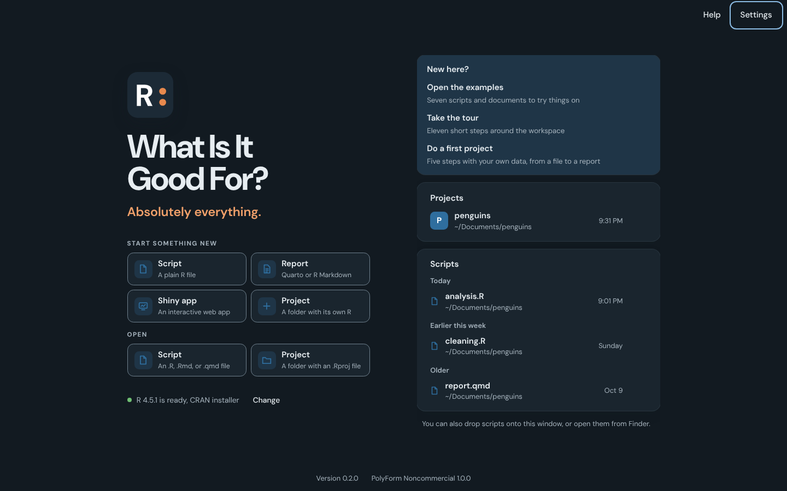

# R: What Is It Good For?

[](LICENSE.md)
[](#requirements)


[](https://github.com/drabhikroy/goodR/releases)

R: What Is It Good For? is a desktop app for writing R. Your script is on
the left; every plot, table, and printed result shows up on a canvas on the
right, linked to the line that made it. It is meant for people new to R and
for people who use it every day. Mac first; Windows and Linux later.

Absolutely everything, as the opening screen says. Clean your data, run the
analysis, write the report, and build the Shiny app in one place.



## What it does

- **Script on the left, results on the right.** Each plot, table, or printed
  result lands on a canvas beside the script and links back to its line.
- **Earlier results** sit in a strip under the canvas. Click one to jump to
  the line that made it, or pin one to compare.
- **Errors in plain English**, with the failing spot marked and a one-click
  fix when the fix is obvious. Fix problems updates retired package code.
- **Ask for help online** writes a forum-ready question: the lines that led
  to the error, a small data sample, and your versions.
- **R Markdown, Quarto, and Shiny** run and render beside the code.
- **An R for each project**, so work in one never leaks into another.
- **Undo the last run**, unsaved work that survives a crash, and earlier
  versions of every script with what changed since.
- **Statistics written up** in APA style, with the assumptions checked.
- **Where did this come from?** traces an object back through the script.
- **Teaching tools**: turn a script into exercises that check themselves.
- **An optional assistant** that runs on your own Mac through Ollama.
- **Layout and look**: hide any part of the window, sixteen code fonts,
  light, dark, and paper themes, and color vision palettes.
- **Updates in one place** for the app, R, packages, Ollama, and models.

The full list, with how each part behaves, is in
[docs/FEATURES.md](docs/FEATURES.md).

## What it does not do

- It is not a fork of RStudio or Positron and does not read their settings
- It does not run code on a server. R runs on your computer
- It does not read data files itself. It lists them by name, and R reads
  them when you run the code that loads them
- It does not open files outside the scripts you choose and the scripts in
  the projects those scripts belong to
- It does not collect usage data, crash reports, or anything else
- It does not install R. It finds the R you have and points you to CRAN when
  there is none
- It does not change your files on its own. Saving, installing, and
  running are always your choice, unless you turn on Save files
  automatically

## Planned

These are designed and will arrive in later releases, in roughly this order.

- Publishing a shared app's web page in one step, to a host you
  choose
- A Git panel for history, committing, and pushing
- Background jobs, with progress, for long scripts
- Results in a separate window, for a second display
- Windows and Linux releases. The code already builds and runs on Linux,
  where the tests below run on every change

## Requirements

- macOS 12 Monterey or later, on Apple Silicon or Intel
- R 4.2 or later, from [CRAN](https://cran.r-project.org/) or Homebrew. R
  4.2 is the oldest version ark supports, and the app names an older R and
  declines to start it rather than failing partway through

Nothing else is needed to write and run R. The R kernel, ark, ships inside
the app.

Rendering reports needs two more things, and the app says which is missing
when you first render:

- The rmarkdown and knitr packages in your R, installed with one button
  when the app finds them missing
- [Quarto](https://quarto.org/docs/get-started/), for Quarto documents and
  for PDFs. R Markdown documents render to HTML and Word without it, as
  long as Pandoc is installed, and Quarto brings its own Pandoc

For PDFs, any one of these is enough: the LaTeX already on your computer,
such as MacTeX, TeX Live, MiKTeX, or TinyTeX; the app's own TinyTeX,
installed with one press from Settings, under Reports, or from a PDF that
needed it; or Quarto alone, whose Typst makes PDFs without LaTeX.

Running Shiny apps needs the shiny package in your R. The App sheet offers
to install it the first time an app runs without it. Sharing an app as a
web page needs the shinylive package, which the Share dialog offers to
install, and the internet the first time, when shinylive downloads its own
web files.

## Install

The first public release is being prepared. Until it is published, run the
app from source as described under [Running from source](#running-from-source).

Once it is published:

1. Download [Good-For.dmg](https://github.com/drabhikroy/goodR/releases/latest/download/Good-For.dmg).
   One universal disk image runs on both Apple Silicon and Intel Macs.
2. Open the downloaded `.dmg`.
3. Drag Good For to the **Applications** folder.
4. Open Good For from **Applications**.

Each release lists a SHA256 checksum beside the disk image. To compare it
with your download:

```bash
shasum -a 256 ~/Downloads/Good-For.dmg
```

## Using R: What Is It Good For?

R starts with the app. The opening screen offers a new project first, then
opening a project, starting a script, or opening one, beside the projects
and scripts you used recently. You can also open scripts by dropping them
on the window or by choosing Open With in Finder, where the app is listed
for R, R Markdown, and Quarto files without taking over as their default.

| To | Press |
| --- | --- |
| Start a new project | ⇧⌘N |
| Open a project | ⇧⌘O |
| Open a script | ⌘O |
| Start a new script | ⌘N |
| Save, or Save As | ⌘S, ⇧⌘S |
| Run the line or selection | ⌘↩ |
| Run the chunk, or a script's section | ⌥⌘C |
| Run the whole file | ⇧⌘↩ |
| Start a new Quarto or R Markdown document | ⌥⌘N |
| Insert a chunk | ⌥⌘I |
| Render the report | ⇧⌘K |
| Run a Shiny app | Run app in the title bar, or Run, Run Shiny App |
| Stop | ⌘. |
| Restart R | ⇧⌘0 |
| Export the plot on show | ⇧⌘E |
| Explain the code at the cursor with the assistant | ⌥⌘E |
| Show the assistant | ⌃9 |
| Insert a pipe, an assignment, or a section | ⇧⌘M, ⌥−, ⇧⌘R |
| R help for the name at the cursor | F1 |
| Show R help, history, or packages over the canvas | ⌃3, ⌃4, ⌃7 |
| Move to the canvas, or to the objects in R | ⌃6, ⌃8 |
| Search for any command, or look a function up in R help | ⌘K |
| Help for this app | ⇧⌘/ |
| Show results in the canvas, or under each line | ⌥⌘1, ⌥⌘2 |
| Update results as you type, on or off | ⌥⌘L |
| Show or hide the project sidebar | ⌃⌘S |
| Show or hide the canvas | ⌥⌘0 |
| Show past commands | ⇧⌘Y |
| Show the start screen, without closing anything | ⇧⌘H |
| Move to the editor or the R prompt | ⌃1, ⌃2 |

On Windows and Linux, Ctrl takes the place of ⌘ and Alt the place of ⌥, and
the app shows them that way. The sidebar shortcut there is Ctrl B.

A project's R works in the project folder. Opening a project leaves your
other work open in its own sessions. Closing a project ends its R, and
closing a script that is on its own ends that script's R. A new untitled
script runs in the session of the tab in front, or, with nothing open, in
an R kept for untitled work. Drag the left edge of the canvas, or focus it
and press the left and right arrow keys, to change its width.

Restart R, in the Run menu, restarts the R of the script in front only.
The menu at the top left switches between open projects and scripts.
Choose R Version, in Settings under R and packages or the Run menu,
restarts every session with the new R. Settings is grouped into
Appearance, Layout, Code text, Editor, Results, Reports, Accessibility,
R and packages, Updates, and Menus. Every change
applies at once, so there is nothing to save. Typing three characters of a name, or pressing
Tab, shows completions from R; Tab or Return takes the highlighted one.

## Your data

The app reads and writes only scripts: R, R Markdown, and Quarto files. A
script becomes available to it when you choose it in the Open or Save
dialog, drop it on the window, open it from Finder, or reopen it from the
recent list. Opening a project, or a script inside one, adds the scripts
inside that project's folder, and nothing else. To find a script's
project, the app lists the folders above the script, up to but not
including your home folder, looking only at file names for a `.Rproj`
file. It reads no file contents on the way. Data files, whether listed in a project or
chosen in Import Data, are never opened by the app. R reads them: for the
preview, and when the import code runs. Help pages are R's own, rebuilt
from an allowlist of plain tags so they cannot run code or reach the
network.

The list of what may be opened is kept by the app's own code, which the
interface cannot add to, so a file you never chose stays out of reach.
Dialogs for opening, saving, and choosing a project folder run in that same
code rather than in the interface.

Settings, the recent scripts and projects, and what to reopen at launch are
kept in one file,
`~/Library/Application Support/app.goodfor.ide/settings.json` on the Mac. A
damaged settings file is set aside under a new name rather than deleted.

Unsaved changes are copied to the app's own storage on this computer as you
type, so a crash never loses them, and each copy is removed once its file
is saved or closed. For Undo, R keeps references to your objects as they
were before the last run, in memory only, until the next run. Timing a
run writes R's samples to a temporary file that R removes when it quits.

The data viewer asks R for one page of rows at a time and keeps nothing
after the tab closes. Exporting a plot runs the code that drew it in a
scratch environment, so nothing it assigns reaches your workspace, and puts
the random number state back afterward.

R itself can read and write anywhere your user account can, exactly as it
does in a terminal or in any other R environment. The app does not limit
what your code does.

## The assistant

The assistant is optional and stays off until you set it up from its
button on the canvas, beside R help, Packages, and History. It runs through
[Ollama](https://ollama.com), a free program that runs language models on
your computer.

1. **Ollama.** Use the Ollama already on your Mac, or install a private
   copy inside the app. The private copy is Ollama 0.40.3, a 167 MB
   download checked against Ollama's published SHA-256 before it is
   unpacked. It lives in
   `~/Library/Application Support/app.goodfor.ide/assistant`, runs only
   while the app is open, on a port of its own, and is removed with its
   models from the same screen.
2. **This Mac.** If you agree, the app reads your Mac's memory, free disk
   space, and chip, to mark which models fit. You can skip this step.
   Nothing is saved or sent.
3. **Models.** A short list of free code models, Qwen2.5 Coder in three
   sizes and Qwen3 Coder, each with what it is good and weaker at for help
   with R, how much it downloads, and whether it fits your Mac. The
   suggestion is the largest that fits well.
   Models you already downloaded with Ollama are found and can be used.
   Add, remove, and switch models at any time.


What the assistant sees: the code you ask about, R's error message, the R
version, and the names of the objects in your session, with column names
for tables. It never sees the values in your data. What it writes is a
suggestion. Code goes into your script only when you press Insert or
Replace, R's parser checks it first without running it, and Undo takes it
back out. Replace appears only when the suggestion is a reworked version of
the code you asked about, never for a different step that would wipe it
out. A suggestion that only installs packages offers Put in the Console
instead, which places it at the R prompt, since an install is done once
and does not belong in the script.

## Accessibility

- Five color vision palettes, standard, deuteranopia, protanopia,
  tritanopia, and monochrome, each in Light, Dark, and Paper. An automated
  audit runs over 2,000 checks of WCAG 2.2 AA contrast, and confirms that
  states such as warning and error stay distinguishable under simulated
  color vision deficiency. A palette recolors the whole window, buttons,
  links, focus rings, and selection, along with status, code, and plots
- Meaning never depends on color alone. Each state also carries its own
  icon shape and words, such as a triangle and "did not run"
- Appearance follows the system or can be set to light or dark
- Text size from 90 to 150 percent, scaling the whole interface, controls
  included, with code sized on its own from 11 to 24 points
- Every pointer target is at least 44 pixels tall, checked by a test on
  each screen
- Animation stops when the system asks for reduced motion, or when you turn
  on Reduce motion in Settings
- Visible focus on every control, focus kept inside open dialogs and
  returned when they close, menus that move with the arrow keys and close
  with Escape, and full keyboard use through shortcuts and the command
  palette
- Controls are labeled in words rather than icons alone, and every menu
  item shows its keyboard shortcut
- Run results and status changes are announced through live regions
  without moving focus, including what went wrong when a line fails. A
  streaming assistant answer is announced once, when it is finished, rather
  than word by word. Controls carry names and roles for screen readers,
  and every screen passes automated WCAG 2.2 A and AA checks with axe in
  every appearance

Automated checks catch a great deal but not everything. Reports from people
using VoiceOver or other assistive technology are especially welcome.

## How it works

The app is built with [Tauri](https://tauri.app/). A small Rust core owns the
window, the files, and R. The interface is React and TypeScript shown by
the system's own web view, WebKit on the Mac, so the app stays small and
starts quickly. The editor is CodeMirror 6.

The Open and Save dialogs run in the Rust core rather than the interface,
so the paths they return are known to come from you. The core keeps the set
of files you chose, plus the open project's folder for scripts only, and
checks every read and write against it. A new project can only be created
in the folder you just chose in its dialog.

R runs in [ark](https://github.com/posit-dev/ark), the R kernel Posit wrote
for Positron, as a separate process. The Rust core speaks the Jupyter
protocol to it over ZeroMQ on loopback ports, with every message signed by a
key generated for that session. Each run carries an id chosen by the
interface before it is sent, so output can never arrive for a run the
interface does not yet know about. Runs are queued and go one at a time, so
output arrives in order and Run File stops at the first error, as sourcing
a script does.

A few helper functions written in base R are attached to the session as
`tools:goodfor`, the way RStudio attaches `tools:rstudio`. They describe
objects, size plots to the canvas, set the plot palette, check for missing
packages, page through data frames for the viewer, and export plots. They never appear among your objects or mask a name you define.

Plots are rendered by R at the width of the canvas they appear in,
at the display's pixel density, so they arrive sharp instead of being
scaled. ark sends a line that adds to a plot, such as `abline()`, as an
update to the plot already on screen, and the app redraws that plot in
place.

When a line will not parse, ark's message does not say where. The app asks
R's parser, through a helper that parses the code without running it,
which names the line and column, so the spot can be marked.

Reports render in `crates/render`. A Quarto document runs `quarto render`
and an R Markdown document runs `rmarkdown::render()` in a new Rscript,
both with the R chosen in the app, in the report's own folder. The program
starts in a process group of its own, so Stop ends it along with every R
it started. knitr's progress lines drive the progress bar, and when a chunk
fails, knitr's "Quitting from lines" note names the chunk, so the
interface can find the exact line within it. The preview loads the report
through Tauri's asset protocol, which is opened only for the folder of a
report the app has just rendered, inside a sandboxed frame.

Sharing an app runs `shinylive::export()` in a new Rscript, into a new
folder named after the app inside the folder chosen in the system dialog,
so it never writes into a folder that already holds something. A single
file app is copied alone into a folder of its own first, so nothing beside
it is bundled. The preview serves that folder from the Rust core on a
loopback port, with `.wasm` files served as WebAssembly, since browsers run
the page only from a web address. Only folders an export made in this
session can be served or shown in Finder.

Shiny apps run in the same crate, from its `shiny` module, which follows
the app's R the way a render is followed and stops it the same way. The
app runs `shiny::runApp()` in a new Rscript in the app's own folder, on a
loopback port the system picks as free, with Shiny's own reloading turned
on, so saving a file of the app reloads it. Shiny names its address a
moment before it answers there, so the pane waits until the port accepts
a connection before showing the app. Errors inside the running app reach
the pane as Shiny prints them, as warnings that leave the app running,
and a syntax error that stops it names the file, line, and column.

The assistant lives in its own crate, `crates/assistant`. It finds Ollama,
downloads and checks the private copy with the macOS tools `curl` and
`tar`, lists and downloads models, and streams answers over Ollama's local
HTTP interface on the loopback address, bypassing any proxy so requests
cannot leave the machine.

## For developers

### Project layout

```text
crates/rsession/     Talks to R. Finds installations, starts ark, speaks
                     the Jupyter protocol. No interface code, so its
                     tests run against a real R without a window.
  tests/integration/ Tests against real R through the pinned ark.
crates/assistant/    The optional assistant: finding or installing
                     Ollama, the model list and fit check, reading the
                     Mac's specs, and the prompts for each kind of help.
crates/render/       Rendering reports: finding Quarto, choosing the
                     program for each format, following its progress,
                     stopping it, and reading why it failed. Running
                     Shiny apps the same way.
  tests/             Renders real reports with Quarto and R, and runs
                     real Shiny apps.
src-tauri/           The desktop app. Commands, menus, settings, project
                     templates, and file access limited to the scripts
                     you open.
src/                 The interface.
  components/        React components, one file per area of the window.
  lib/               The controller, editor setup, statement splitter,
                     package detection, and error explanations.
  theme/             Color tokens for every palette and appearance.
tests/unit/          Unit tests for the interface logic.
tests/ui/            Interface and accessibility tests in a browser.
scripts/             Downloading ark, the standards gate, and the color
                     audit.
design/icon/         The icon source and the script that builds every
                     size from it.
docs/               The design rationale, with its sources.
  images/           Screenshots and icon variants for this README.
```

### Dependencies

Tauri provides the desktop shell, and React and CodeMirror the interface.
DM Sans and DM Mono are bundled from Fontsource, so nothing is fetched from
the network at run time. The Rust side uses the pure Rust `zeromq` crate, so
building needs no system ZeroMQ library.

ark is not committed to the repository. `scripts/fetch-ark.mjs` downloads
the pinned release from Posit and checks its SHA256 against values recorded
in the script before anything uses it.

### Running from source

You need Node.js 22, Rust 1.90 or later, and R 4.2 or later.

```bash
npm install
node scripts/fetch-ark.mjs
npm start
```

`npm start` builds the Rust core once and opens the app. Changes to the
interface appear live. Changes to the Rust code need the app quit and
`npm start` run again; `npm run tauri dev` rebuilds them automatically
instead.

Keep the project out of folders that a sync service manages, such as
Documents or Desktop when iCloud Drive syncs them. A sync service touches
every file it uploads, and file watchers see each touch as an edit. The
interface ignores touches that leave a file unchanged, and `npm start`
does not watch the Rust code, but `npm run tauri dev` will rebuild and
restart the app for every touch. A folder such as `~/Developer` is not
synced.

`npm run dev` alone serves the interface in a browser with a stand-in for
R, which is handy for working on layout.

### Tests and standards gates

```bash
npm run verify
npm run test:ui
```

`npm run verify` runs, in order, the writing standards gate, the color
contrast audit, a type checked build, the unit tests, and the Rust tests.
The Rust integration tests start a real R through ark and check values,
plots, plot updates from lines such as `abline()`, errors, parse positions,
the data viewer's pages, plot export at exact sizes, interrupting a long
run, answering a `readline()` prompt, and recovering from a crash. The
assistant's tests check the fit rules, the prompts, reading streamed
answers and download progress from a stand-in server, and installing the
private copy from a checked archive, including refusing one whose checksum
differs. They fail rather than skip when R or ark is
missing. The Shiny tests run real apps, from an app.R folder and from a
single script, check that saving reloads the app and that Stop frees its
port, and check that a syntax error is named with its file and line. A
further test exports a real app with shinylive and serves the page; it
needs the shinylive package and the internet. The tests need the packages
they use, and say so and pass without running when one is missing. The
preview server's own tests check content types and that requests cannot
reach outside the exported folder. The render tests render real Quarto and R Markdown documents to
HTML, Word, and PDF, check that a failing chunk is named with its lines,
and stop a long render and confirm its R is gone. They need Quarto and the
rmarkdown and knitr packages, and say so and pass without rendering on a
machine that lacks them. The continuous integration machines have all of
them, and shiny too.

`npm run test:ui` runs the interface tests in Chromium, including axe
accessibility checks in every appearance and the 44 pixel target check on
every screen, every Settings section, and every state of the Report
pane. The preference tests check that
the code typeface, size, and spacing reach the editor, that editor
switches take effect, that plain results and results in the canvas work,
and that a copy across several results under each line holds them all.

The standards gate rejects em and en dashes, contractions, a banned list of
words, and British spellings in every source and document file, and holds
logic files to a 10 percent comment floor. A line can opt out by carrying a
comment that begins `standards:` and says why.

### Building distributable packages

```bash
npx tauri build --target universal-apple-darwin --bundles app,dmg
```

This needs both Mac Rust targets and the universal ark:

```bash
rustup target add aarch64-apple-darwin x86_64-apple-darwin
node scripts/fetch-ark.mjs universal-apple-darwin
```

Output is written to `target/universal-apple-darwin/release/bundle/`.

Build outside iCloud Drive. Folders that iCloud syncs, including
`~/Documents` and `~/Desktop` when Desktop and Documents syncing is on,
attach extended attributes that `codesign` refuses.

### Code signing and verification

The Mac app is signed with a Developer ID Application certificate, uses the
hardened runtime, and is notarized by Apple. ark is signed with the same
certificate and the entitlements in `src-tauri/entitlements.plist`, which
allow it to load libR and package libraries signed by the R Foundation and
other developers.

Releases are built on GitHub Actions by
`.github/workflows/release-macos.yml`, which runs by hand with
`gh workflow run release-macos.yml --ref v1.2.3`. It signs and
notarizes the app, confirms ark carries its entitlement, runs the R
integration tests against the signed ark, notarizes and staples the disk
image, and attaches it to a draft release. The certificate and Apple
credentials are repository secrets: `CSC_LINK` and `CSC_KEY_PASSWORD` for
the certificate, and `APPLE_API_KEY_P8`, `APPLE_API_KEY_ID`, and
`APPLE_API_ISSUER` for the App Store Connect API key that notarizes it. The
key is the `.p8` file made under Users and Access, then Integrations, in App
Store Connect. The certificate signs; the key only notarizes, so both are
needed.

To make the same signed disk image on a Mac instead, with the certificate in
the login keychain, save the API key as a notarization profile once, then
run the script:

```bash
xcrun notarytool store-credentials "GoodFor" \
  --key ~/private/AuthKey_XXXXXXXXXX.p8 --key-id XXXXXXXXXX --issuer ISSUER-ID
scripts/release-mac.sh
```

It runs the checks, then builds, signs, notarizes, and staples the app and
`Good-For.dmg`, and writes `Good-For.dmg.sha256` beside it.

Installed copies update themselves through Tauri's updater, which checks
each download against a public key built into the app. To turn this on,
make a key pair once and keep the private half safe:

```bash
npx tauri signer generate -w ~/.tauri/goodr.key
```

Add the private key, and its password if it has one, as the repository
secrets `TAURI_SIGNING_PRIVATE_KEY` and
`TAURI_SIGNING_PRIVATE_KEY_PASSWORD`, and the public key, the text in
`~/.tauri/goodr.key.pub`, as the repository variable
`GOODR_UPDATER_PUBKEY`. A release built with them carries
`Good-For.app.tar.gz` and `latest.json`, which installed copies read once
the release is published. A build without them still works, and its
Updates page links to the release page instead.

To confirm an installed copy is signed and notarized:

```bash
codesign --verify --deep --strict --verbose=4 "/Applications/Good For.app"
spctl --assess --type execute --verbose=4 "/Applications/Good For.app"
```

The second command should report `accepted` and `source=Notarized Developer
ID`.

## Contributing

The reasoning behind the interface, with the research each decision rests
on, is in [docs/DESIGN.md](docs/DESIGN.md). See
[CONTRIBUTING.md](CONTRIBUTING.md) for how the code is organized and what
the checks expect, [SECURITY.md](SECURITY.md) for how to report a
security problem, and [CODE_OF_CONDUCT.md](CODE_OF_CONDUCT.md).

## Credits and background

The name comes from the question people new to R often ask, with a nod to
the song. The answer on the opening screen is the point of the app.

R runs through [ark](https://github.com/posit-dev/ark) by Posit Software,
PBC, used under the MIT License. Its license and notice ship inside the app.
The interface is set in DM Sans and DM Mono, used under the SIL Open Font
License.

## License

[PolyForm Noncommercial License 1.0.0](LICENSE.md). The full text is also at
<https://polyformproject.org/licenses/noncommercial/1.0.0>.

Personal use, personal study, hobby projects, teaching, academic research, and
use by charitable, educational, nonprofit, public research, public health, and
government organizations are permitted. Commercial use is not permitted without
a separate license.

Required notice: © 2026 Abhik Roy.

DM Sans and DM Mono are used under the SIL Open Font License. ark is used
under the MIT License.
