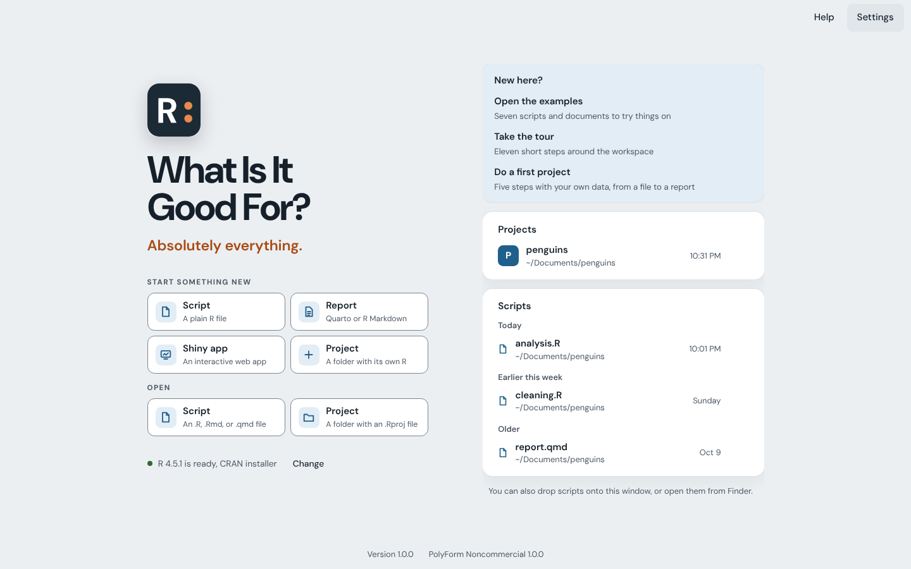

# R: What Is It Good For?

[](LICENSE.md)
[](#requirements)


[](https://github.com/drabhikroy/goodR/releases)

R: What Is It Good For? is an integrated development environment (IDE) for R. Results appear next to the code that made them and errors are explained in plain words. It suits people who are learning R, teaching it, or using it for research.

The app is available for macOS today. Windows and Linux versions are planned.

Everything runs on your computer. No account is needed and the app collects no data about you or your work.

<picture>
  <source media="(prefers-color-scheme: dark)" srcset="docs/images/opening-dark.png">
  
</picture>

## What it does

Your script is on the left side of the window and your results are on the right. Run a line and its result appears beside it. Click a result later and the app takes you back to the line that made it.

<picture>
  <source media="(prefers-color-scheme: dark)" srcset="docs/images/workspace-dark.png">
  
</picture>

- **Results beside the code.** Run a line, a section, or a whole script. Each plot, table, or printout lands on the canvas. Earlier results stay in a strip underneath so you can go back to them.
- **Errors in plain words.** A failed line is explained in everyday language and marked in your script. R's own message is one click away. Common problems come with a button that fixes them.
- **Old code brought up to date.** Fix problems finds functions and arguments that packages have retired and updates them in one step.
- **Questions ready to post.** Ask for help online writes up a question for a forum. It includes the code that led to the error, a small sample of the data, and your versions.
- **A data viewer that writes code.** Each column shows its type, a small chart, and its missing values. When you filter or rename in the viewer, the matching line of R is added to your script.
- **Reports.** R Markdown and Quarto documents render to HTML, Word, and PDF beside the code. The preview can update every time you save.
- **Shiny apps.** An app runs next to its code. A map shows how its inputs and outputs connect. Likely mistakes are flagged before the app runs. An app can also be shared as a web page.
- **One R for each project.** Objects from one project never turn up in another.
- **Ways back.** Undo the last run. Get unsaved work back after a crash. Compare a script with any of its earlier versions.
- **Statistics written up.** Tests and models come with a sentence in APA style and a check of their assumptions.
- **Where did this come from?** Trace any object back through the lines that made it.
- **Teaching tools.** Turn a script into exercises that check each answer.
- **An optional assistant.** It explains errors and code and drafts R from a comment. It runs on your own computer through Ollama.
- **Learning built in.** A short tour, examples built on real data, and a guided first project that goes from a data file to a report.
- **Your own look.** Light, dark, and paper themes. Palettes for different kinds of color vision. Sixteen code fonts. Any part of the window can be hidden.
- **Updates in one place.** One page lists updates for the app, R, your packages, Ollama, and assistant models.

The [feature guide](docs/FEATURES.md) describes every feature in detail with screenshots.

## What it does not do

The app is not a version of RStudio or Positron. It does not read their settings.

It does not run your code on a server. R runs on your computer.

It does not open your data files itself. R reads them when your code runs. The app opens only the scripts you choose and the scripts in their projects.

It does not install R. It finds the R you already have.

It never changes your files on its own. Saving, installing, and running happen only when you ask. The one exception is Save files automatically, which you can turn on in Settings.

## Requirements

- macOS 12 Monterey or later
- An Apple silicon or Intel Mac
- R 4.2 or later

The app uses the R already on your computer. If you do not have R yet, install it before the app.

1. Open [R for macOS](https://cran.r-project.org/bin/macosx/) on CRAN, the official download site.
2. Download the installer for your Mac. Choose arm64 for Apple silicon or x86_64 for Intel. To check which Mac you have, choose About This Mac from the Apple menu. A chip name that starts with Apple means Apple silicon.
3. Open the downloaded file and follow the steps.

Some features need a little more. The app tells you when something is missing.

| To | You also need |
| --- | --- |
| Render R Markdown | The rmarkdown and knitr packages, which the app installs with one click |
| Render Quarto documents | [Quarto](https://quarto.org/docs/get-started/) |
| Make PDFs | LaTeX or Quarto. The app can install a small LaTeX for you |
| Run Shiny apps | The shiny package, which the app offers to install |

## Install

1. Download `goodR-1.0.0.pkg` from the [latest release](https://github.com/drabhikroy/goodR/releases/latest).
2. Open it and follow the steps. macOS asks for an administrator password because the installer puts the app in your Applications folder.
3. Open goodR from the Applications folder. It finds R and starts it. If there is more than one version of R it asks which one to use.

The installer is signed and notarized by Apple so macOS opens it without a warning. Quit goodR before installing a newer version over an older one.

### Checking the download

Each release includes `SHA256SUMS.txt`. Put it in the same folder as the installer and run this command. It should report `OK`.

```bash
shasum -a 256 -c SHA256SUMS.txt
```

### Removing the app

1. Quit goodR.
2. Move goodR from the Applications folder to the Trash.

Your scripts and reports stay where you saved them. To also remove the app's settings and saved versions, delete the folder `~/Library/Application Support/app.goodfor.ide`.

## Using the app

1. Open goodR. Start a new script, open one you already have, or choose **Open the examples**.
2. Put the cursor on a line of code and press Command Return.
3. The result appears on the right. Keep going line by line or press Shift Command Return to run the whole file.

New to the app? Choose **Take the tour** on the opening screen. It shows each part of the window in a couple of minutes.

Help is under the Help menu or Shift Command /. It has a search box and answers to common questions. Each topic can point to the part of the window it describes. The keyboard shortcuts are listed in the [feature guide](docs/FEATURES.md#keyboard-shortcuts-and-sessions).

## Your data

Your code and data stay on your computer. The app sends no usage data and no crash reports. The only connections it makes on its own are update checks. They ask GitHub, CRAN, and Ollama for version numbers and nothing else. You can set them to happen only when you ask.

| What the app keeps | Where | How long it stays |
| --- | --- | --- |
| Settings and recent files | `~/Library/Application Support/app.goodfor.ide/settings.json` | Until you reset the app or delete the file |
| Earlier versions of each script | `~/Library/Application Support/app.goodfor.ide/history` | The latest 100 versions of each script |
| Unsaved changes | The app's private storage | Until the file is saved or closed |
| Recent results | The app's private storage | The latest 60, until you clear them |
| The assistant's Ollama and models | `~/Library/Application Support/app.goodfor.ide/assistant` | Until you remove them from the assistant's setup |
| The app's own LaTeX, if you install it | `~/Library/Application Support/app.goodfor.ide/TinyTeX` | Until you delete the folder |

[Your files and your privacy](docs/PRIVACY.md) explains which files the app may open and what the assistant can see.

## Accessibility

- **Standard.** The app is built to meet WCAG 2.2 at the AA level. Every screen is checked with automated tests in every theme.
- **Keyboard.** Everything can be done from the keyboard. Every control shows where focus is.
- **Screen readers.** Buttons and controls have names. Results and errors are announced as they happen without moving focus.
- **More than color.** Each state has its own icon and words as well as its own color.
- **Color vision.** Five palettes cover standard vision, deuteranopia, protanopia, tritanopia, and monochrome.
- **Size and motion.** Text scales from 90 to 150 percent. Animation stops when Reduce Motion is on.

Automated tests cannot catch everything. If something gets in your way, please [open an issue](https://github.com/drabhikroy/goodR/issues). The full list is in [Accessibility](docs/ACCESSIBILITY.md).

## Help and feedback

To report a problem or suggest an idea, [open an issue](https://github.com/drabhikroy/goodR/issues). To report a security problem privately, see the [security policy](SECURITY.md).

## For developers

[Developing goodR](docs/DEVELOPING.md) covers building from source, the tests, how the app works inside, and how releases are signed. [CONTRIBUTING.md](CONTRIBUTING.md) has the conventions and checks. [docs/DESIGN.md](docs/DESIGN.md) explains the design and the research behind it. Please also read the [code of conduct](CODE_OF_CONDUCT.md).

## Credits and background

The name comes from the question many people ask when they first meet R. It is also a nod to the song. The answer on the opening screen is "Absolutely everything."

R runs inside the app through [ark](https://github.com/posit-dev/ark) by Posit Software, PBC. It is used under the MIT License and its license and notice ship with the app. The interface uses the DM Sans and DM Mono typefaces under the SIL Open Font License.

## License

[PolyForm Noncommercial License 1.0.0](LICENSE.md). The full text is also at <https://polyformproject.org/licenses/noncommercial/1.0.0>.

Personal use, personal study, hobby projects, teaching, academic research, and use by charitable, educational, nonprofit, public research, public health, and government organizations are permitted. Commercial use is not permitted without a separate license.

Required notice: © 2026 Abhik Roy.
