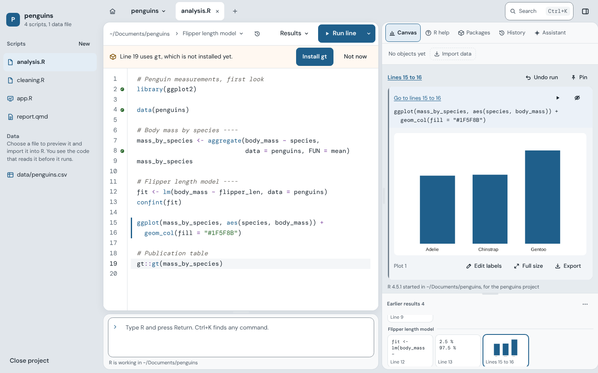
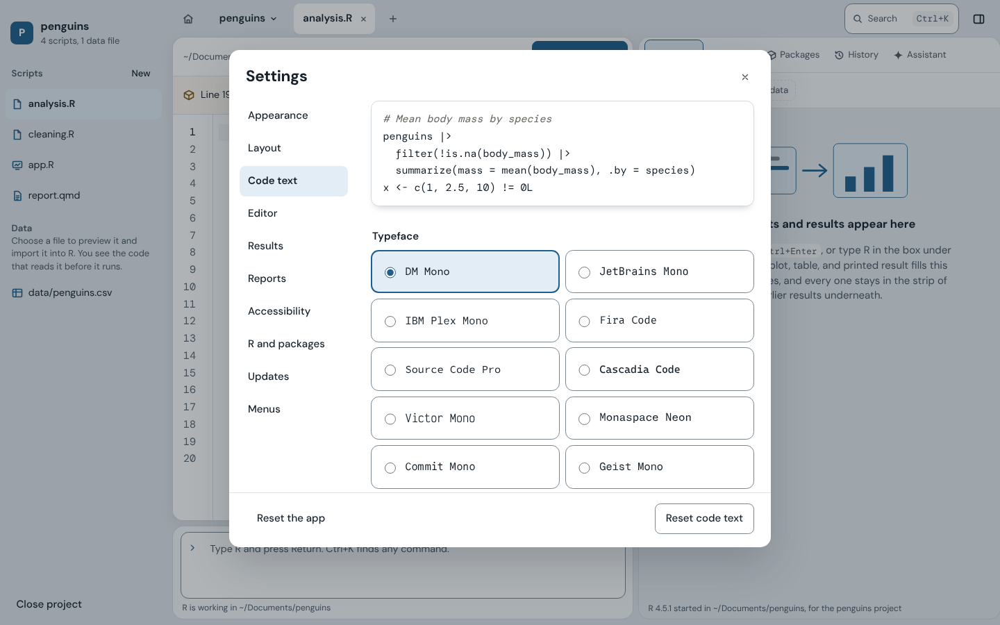
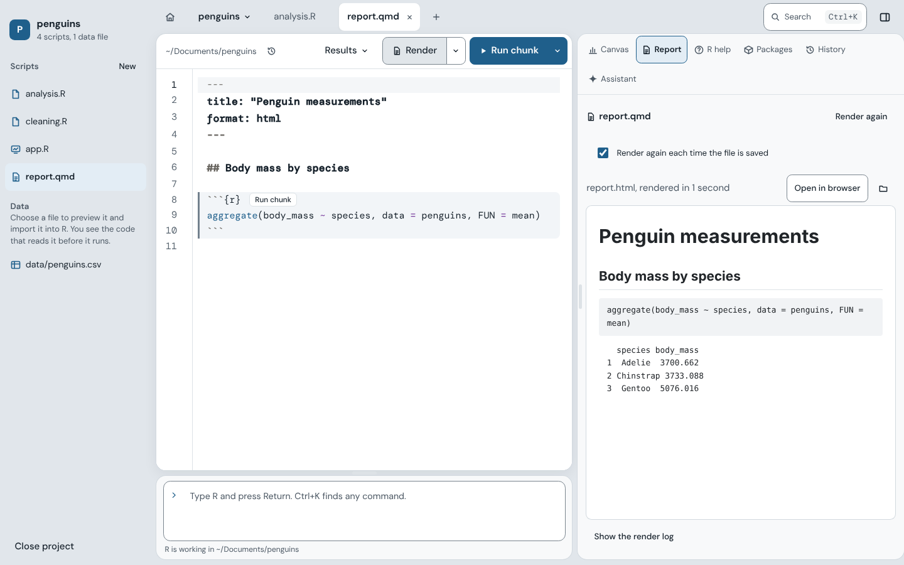
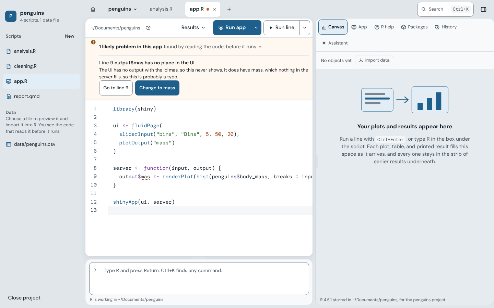
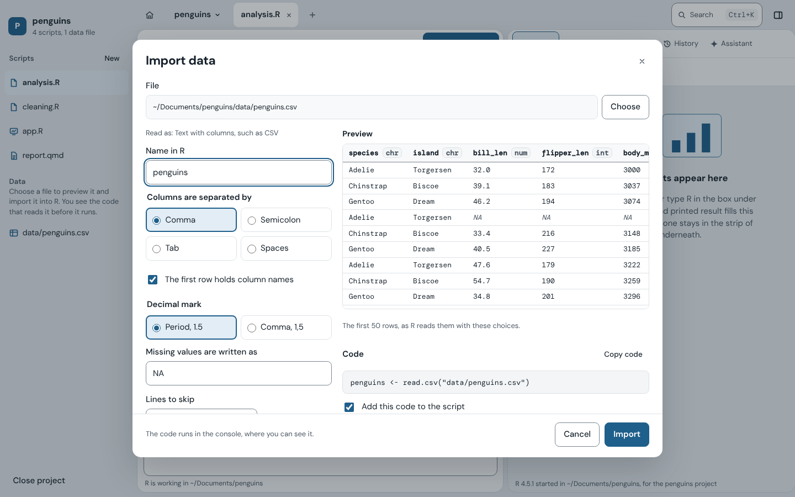
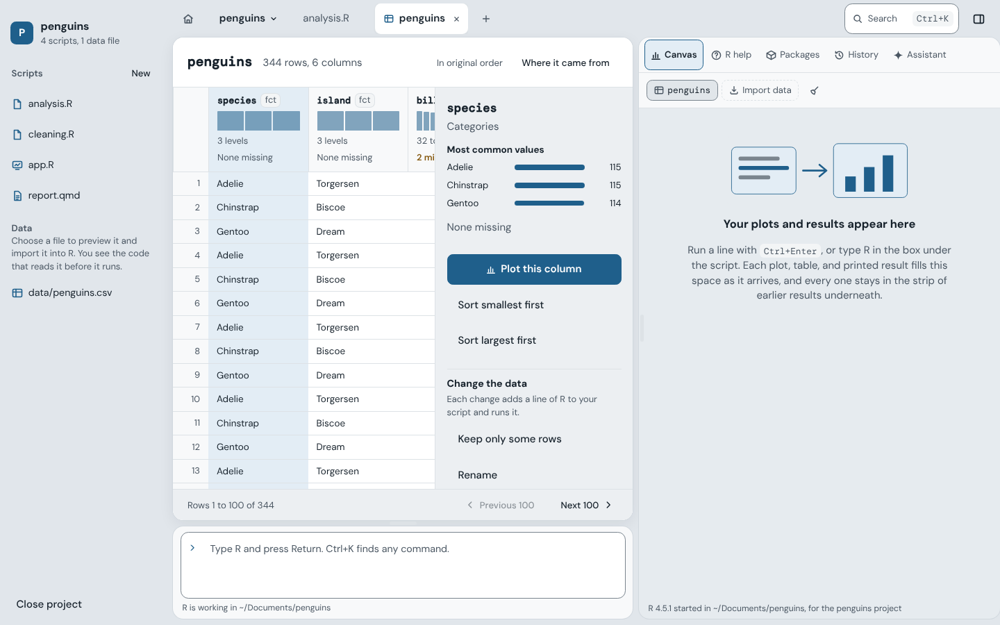
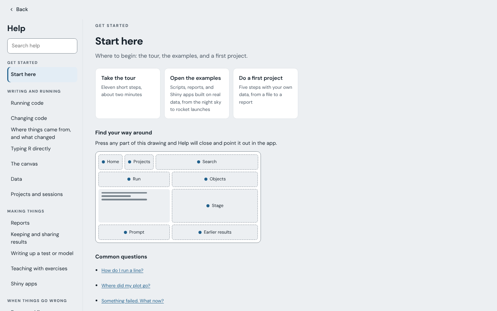
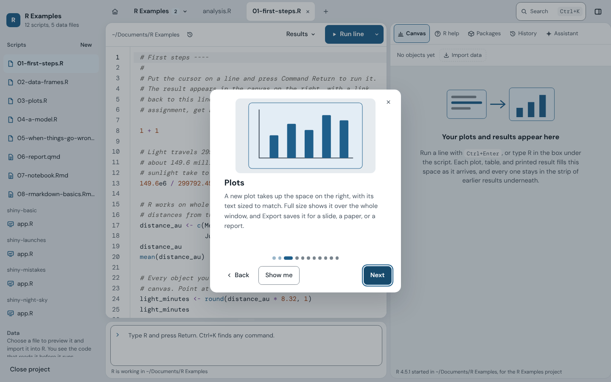

# Features in detail

The README has the short version. This is the long one, grouped roughly by
what you are doing at the time.

## The workspace

There is no console drawer and no column of tabs. The canvas beside the
script shows one output at a time on a stage, as large as the space allows.
A plot is scaled to fill it, a data frame is shown by its name as a table you
can sort, and printed text sits in a block that is easy to read. A new output
takes the stage as it arrives. Putting the cursor on a line brings back what
that line made, so the stage follows your reading of the script. The stage
names the line, and pointing at that name lights the line up.

Under the stage, a strip holds every output of the session as a small card,
grouped under the name of the script section it came from. Each card is one
press or one arrow key away. Drag the strip's top edge to make it taller and
the cards wrap into more rows. A menu at its top right saves the cards as a
report, clears them, or hides the strip. Pressing a card puts the script's
cursor on the line that made it. It works the other way too: clicking a line
brings its output to the stage, and a bar runs down the line's edge while it
is there. Once there are more than a handful of outputs, filters narrow the
strip to plots, printed results, or problems.

You can pin an output to keep it on the stage above the current one, which is
how you compare two plots, or a plot and the table behind it. Full size shows
a plot over the window, and Export sits on the plot itself. Statements that
print nothing, such as an assignment, get a small check in the gutter
instead. A line that adds to a plot, such as `abline()` or `legend()`,
redraws that plot in place.

The R prompt is a box under the script, on the same side, where your eye
already is while you write R. What it runs takes the stage and joins the
timeline beside results from the script. It colors R the way the script
does, completes names with Tab, continues unfinished statements, walks back
through what you typed with Up, and answers `readline()` prompts.

The objects in R sit as small cards along the top of the canvas. A data frame
opens in the data viewer; anything else says what it is. R help, Packages,
History, the assistant, and a rendered report or running app slide over the
canvas as sheets from the buttons beside the cards, and close back to it.
Running code brings the stage back out from under a sheet, so you always see
the result.

The title bar holds Home, the project or script on show (with a menu to
switch), the open tabs, and at the right a search for commands and R help. A
dot beside the project's name shows while R is busy or has stopped. A bar
across the top of the document holds what acts on it: where the file is, the
section the cursor is in, where results go, Render for reports, Run app for
Shiny apps, and Run. Every edge can be dragged. RStudio's shortcuts work, from
Control and a number to move between views to Shift Command M for a pipe.

The Home icon at the left of the title bar shows the opening screen over your
work, the way a browser's home button would. Nothing closes, R keeps running,
and every open script stays open behind it. Continue working, its own
shortcut, or Escape brings the workspace back exactly as it was, and so does
starting or opening anything from the opening screen.

Layout, in Settings, shows a small picture of the window. Press a part (the
project sidebar, the R prompt, the canvas, or the earlier results) to hide or
show it. The View menu has the same switches. Go back to the standard layout
shows every part at its first size in one press.

A compact layout for small screens keeps every target easy to hit, and
documents wrap at a comfortable line length. Focus mode, Option Command F,
leaves only the script and the result on the stage, with Leave focus always
in view.

<picture>
  <source media="(prefers-color-scheme: dark)" srcset="images/workspace-dark.png">
  
</picture>

## Text and themes

The interface text is larger by default and scales from 90 to 150 percent.
Code has its own settings. There are sixteen typefaces, each shown in a
sample that stays in view while you choose, a size from 11 to 24 points,
three line spacings, and joined symbols for typefaces that have them.

Two of the typefaces are pairings with a script face for comments. One is
Fira Code iScript, used when it is installed and otherwise made from Fira
Code with Victor Mono's italic. The other is JetBrains Mono with Monaspace
Radon's handwriting. Script italics adds Victor Mono's italic comments to any
of the other typefaces.

Line numbers, the current line band, wrapping, closing brackets, brackets
colored by depth, and indent width are each one switch. There are three
themes, Light, Dark, and Paper (a warm page for long reading), and each
passes the same contrast checks.

<picture>
  <source media="(prefers-color-scheme: dark)" srcset="images/settings-code-dark.png">
  
</picture>

## Running code

Run is a split button. It runs a line in a script and a chunk in a document.
Its arrow lists every way to run, each with its shortcut: a line or
selection, the chunk or section the cursor is in, the whole file, or up to
the cursor. The same menu sets what the button runs for that one file, so a
script you always run top to bottom can have a Run file button of its own. In
a script, a section is the code under a comment such as `# Clean ----`.

If you would rather see results under the code, choose Under each line in the
Results menu. Each result then sits in a tinted well right below the code
that made it, with plots as small copies, and the stage still shows each one
at full size. In this mode, a selection across several lines and results
copies the code and each result in order, as it would read in a console.
Plain text in Settings drops the tint for a more traditional page.

Results as you type is an optional mode that reruns the statement you are
editing after a short pause. Anything that writes files, installs packages,
or changes the session is left alone until you run it yourself.

A run longer than a second shows a slim bar over the results with the line,
the time so far, and Stop. A run of two seconds or more can show where its
time went, function by function, from R's own sampling while it ran.

Option Command Z, or Undo run above a result, puts your objects back as they
were before you pressed Run, and says what it put back. One press of Run is
one run, so a whole Run file undoes at once.

Run a line again and its result says what moved since last time: numbers,
printed lines, objects, and, for plots, a before and after slider.

Results come back the next time a file opens, marked as from last time,
beside the code that made them. Save as report, under the timeline, turns
the results on the canvas into a Quarto document with one chunk per result.

Check it runs from scratch, in the Run menu, runs the script in a new R with
nothing left over from your work. If a line fails there, it is named, with
the reason it most likely fails.

## R itself

R starts with the app, before anything is opened. If the window reloads, the
app reconnects to the R already running, so your objects and unsaved edits
are kept.

Every project has its own R, and so does every script that belongs to no
project. Open a script from anywhere (Finder, the Open dialog, or the recent
list) and the app looks for a `.Rproj` in the folders above it. If it finds
one, the script runs in that project's R, beside the project's other
scripts. If not, the script gets an R of its own, started in its folder, so
`"data.csv"` means the file beside it. Several projects can be open at once.
The canvas, objects, plots, history, and project sidebar follow the tab in
front, so you do not have to keep track of which session a file landed in.
The name of the project or script on show sits at the top left, with a count
when several are open, and its menu switches between them and opens recent
projects.

The app looks in the standard install folders for every R version on the
machine, lists the newest first, and lets you switch.

## Projects

Start a project from a template (an analysis, a Quarto report, or a Shiny
app), or turn a folder you already have into one. Git history and renv
package records are a checkbox each. Projects use the standard `.Rproj`
file, so they also open in RStudio. A sidebar lists the project's scripts and
its data files.

## R Markdown, Quarto, and reports

New document starts a Quarto or R Markdown file with a title, author, format,
and two example chunks, so it renders on the first press. Prose is
highlighted as Markdown and code as R. Each chunk sits on a tinted band with a
Run chunk button on its header, and Insert chunk adds one. Running a line, a
chunk, or the whole document sends only the R code, never the header or the
prose.

A Quarto (.qmd) or R Markdown (.Rmd) file gets a Render button. The report
renders in its own fresh R, so it shows exactly what its code makes from a
clean start, and the prompt stays free. Progress shows chunk by chunk, and the
finished HTML or PDF appears on the canvas beside the code, where you can
read it while you edit. The arrow beside the button renders as HTML, Word, or
PDF.

A PDF is made with the LaTeX already on your computer when there is one, such
as MacTeX or TinyTeX. Otherwise it is made with Typst, which comes with Quarto
and needs nothing more. When a document needs LaTeX and you have none, one
press installs TinyTeX, a small LaTeX the app keeps in its own folder, and the
report renders again once it is ready. Settings, under Reports, chooses
between them.

When a chunk fails, the report says why in the same plain words as
everywhere else and underlines the failing line in your script. Once a report
has been rendered, it renders again each time you save it, and the preview
opens at the section you are working on.

Insert citation finds a paper by its DOI or its title, adds it to
references.bib beside the document, names that file in the header, and puts
the citation at the cursor.

<picture>
  <source media="(prefers-color-scheme: dark)" srcset="images/report-dark.png">
  
</picture>

## Shiny apps

A Shiny app gets a Run app button, whether it is app.R, ui.R and server.R, or
any script that ends with `shinyApp()`. The app runs in its own R, so the
prompt stays free while it is open, and it appears on the canvas beside the
code. Save any file of the app and it reloads there by itself. Open in
browser gives the app a full window.

An app that will not start is explained in the same plain words as any error,
with the failing line marked in your script. An error inside a running app,
such as a plot that fails, is explained above the app without stopping it.
The explanation points to the line where it really happened, read from
Shiny's stack trace. It gives the line, the function it was in, the render
call that led there, and the output being made, with Go to line and a fix for
a misspelled name.

As you write an app, its code is read for mistakes Shiny never points out:

- an output or input id spelled differently in the UI and the server
- a reactive used as `data` instead of `data()`
- an input read outside a render function or reactive
- a render function that does not suit its output
- an id used twice

Each is underlined at its line and listed above the script with Go to line,
and with a one press fix where the fix is clear. An app split into ui.R and
server.R is read as one. The App sheet maps how the app connects, from inputs
to reactives to outputs, so an output that reads nothing (often a mistake)
stands out.

Share as a web page, from the arrow beside Run app, makes a folder holding a
page that runs the app in any browser, R included, so whoever opens it needs
nothing installed. It is made with shinylive. Before anything is made, the
dialog lists every file the page will hold and points out any data among
them, since anyone with the address can download what is in it. You can
preview the page in the App sheet as others will see it, then put the folder
on any web host, such as GitHub Pages or Netlify. The app itself uploads
nothing.

<picture>
  <source media="(prefers-color-scheme: dark)" srcset="images/shiny-check-dark.png">
  
</picture>

## When something goes wrong

When a statement fails, the result says what happened in a headline, explains
why in everyday words, and gives one thing to try. It shows the failing line
with the part that went wrong marked by carets and underlines the same part
in your script; Go to the Spot selects it. A misspelled name gets a one click
fix with the name you probably meant. Errors at the prompt get the same
treatment, and R's own message is one click away.

A warning, such as values that would not turn into numbers or rows a plot
left out, is explained the same way, with a round mark instead of an error's
triangle. A package that fails to install says which software it needs on
your computer, with the command that installs it ready to copy.

On a result that failed, one press writes a question the way Posit Community
and Stack Overflow ask for it. It includes only the lines that led to the
error (traced through the script), the error, and the R and package versions.
Data read from a file is replaced by a small sample written with dput(), so
anyone can run it. You review and edit the question, untick the sample if the
data is private, then copy it. Nothing is sent.

A dotted line marks habits that work today and cause trouble later, such as T
for TRUE, 1:length(x), or setwd() in a project. Rest the pointer on it for
the reason and a one click change.

Fix problems in a script is in the Edit menu. It gathers:

- code that packages have retired, such as size for lines in ggplot2 or
  gather() in tidyr
- the deprecations R warned about when the script last ran
- the habits the editor underlines
- failed lines with a clear fix

Each shows the line before and after. Untick any you want to keep, and fix
the rest in one step that one Undo takes back. Changes that need judgment are
listed with what to use instead.

## Not losing work

Unsaved changes are kept as you type and come back after a crash or a quit,
with a note saying so. Saving automatically is a choice in Settings. If R
stops, one press restarts it and runs the script again up to where you were.

Each save also keeps a version of the script, at most one every five minutes,
and the last hundred are kept in the app's own folder. The clock beside the
file's folder lists them by when they were saved, each with a few words on
what has changed since, such as "3 lines added and 1 changed". Choose one to
see each change, with the old lines in red and the current lines in green.
From there you can copy the old lines, put one part back, or use the whole
version, as an edit that Undo takes back.

## Reading and writing code

Names, a function's arguments, and a data frame's columns complete in the
script and at the prompt, from the engine R ships for its own console. Typing
?mean, searching in the title bar, or pressing F1 shows R's own help page,
with links between pages.

Rest the pointer on a function to see what it does and how it is called, or
on an object to see what it holds. In the search, type insert for ready made
code for common tasks, such as reading a CSV file or a t-test. Tab then
selects the parts to fill in, one after another.

Option Command E explains the code at the cursor step by step, in the order R
runs it, with what each function is for, read from R's own help. No
assistant is needed.

You can trace an object back through every line that made and changed it, and
forward to every line that depends on it. One button runs those lines again
after a fix.

Shift Command F finds text in every open file and every script in the
project. F2 renames an object everywhere in the file, and only where it is
that object, after showing each line it will change. Shift Command A tidies
code with styler, in the tidyverse style, as one edit that one Undo takes
back.

Finishing a line with Return also tidies its spacing: around arrows and
operators, after commas, and none inside brackets. Only that line changes,
text in quotes is left alone, and Undo puts it back.

## Data

Import data takes a CSV, Excel, SPSS, Stata, SAS, R, Parquet, Feather, or
JSON file. You see its first rows as R reads them, adjust how it is read, and
see the exact code before it runs. The separator and decimal mark of a text
file are guessed for you, and the code can go straight into your script.

Press a data frame's card and it opens in a tab. Every column header shows
its type, a small chart of its values, its range or most common value, and
how many values are missing. Choose a column for its details, sort by it, or
plot it in one click. If you keep only some rows, rename a column, or remove
one, the line of R that does it goes into your script and runs. Rows load a
hundred at a time, so large data stays quick.

<picture>
  <source media="(prefers-color-scheme: dark)" srcset="images/import-data-dark.png">
  
</picture>

<picture>
  <source media="(prefers-color-scheme: dark)" srcset="images/data-viewer-dark.png">
  
</picture>

## Plots, objects, and statistics

Plots are rendered at the canvas's width, so text in them is readable without
zooming. Each object's card describes it in words, such as "data frame, 344
rows, 8 columns" or "linear model, R squared 0.76".

An optional style, under Results, gives base R and ggplot2 plots the app's
page, text, and grid colors, light or dark.

Export a plot for a slide, a document, or a journal's one or two column
width, as PNG, PDF, or SVG. R draws the plot again at that size, so text
stays in proportion and a PDF stays sharp at any zoom.

A t-test, Wilcoxon test, chi-squared test, correlation, ANOVA, or linear
model gets the APA sentence a paper would use, ready to copy. Its assumptions
are checked in plain words, with what to do when one fails. All of it is read
from R's own result.

## Packages and history

The app reads `library()`, `require()`, and `pkg::` calls, checks which
packages are missing, and offers to install them. You can have it ask every
time or install automatically.

The Packages sheet lists what is installed and attaches a package with a
checkbox. Check for updates opens the Updates page, which lists the packages
with newer versions on CRAN, and Update all updates them. While packages
install or update, the result lists each by name with a progress bar and says
which did not install. R's own log is one press away, or always on show if
you change a setting.

The History sheet lists what was typed at the prompt and sends any of it back
to the prompt or into the script.

## Learning and teaching

Help, in the Help menu, opens over your work without closing anything.
Topics are listed down the left, grouped by what you are trying to do, with a
search box above them, and the one you pick fills the right. It opens on
Start here, which has the tour, the examples, common questions, and a small
map of the window where pressing any part points it out in the app. Each
topic has a Show me button that takes you straight to the part of the app it
names and marks it with rings that widen out from it.

The tour opens by itself the first time. It walks through the workspace in
nine steps, each with a small animated picture, and its own Show me points at
each part in place.

Open the examples, on the opening screen or in the Help menu, copies a small
project into R Examples in your Documents folder and opens it. Instead of the
iris and mtcars data everyone has seen, the examples use real data with a
story in it:

- meteorites seen falling and found on the Antarctic ice (NASA)
- the 894 stars bright enough to see from a town, with their true colors (HYG
  Database)
- planets around other stars, from which a model finds Kepler's third law
  again (Open Exoplanet Catalogue) <!-- standards: proper name -->
- sixty years of space launches (Jonathan McDowell)

There are first steps, data frames, plots, a model, errors made on purpose, a
Quarto field guide to the night sky, two R Markdown files, and four Shiny
apps, one of them with mistakes for the checker to find. They run on a fresh
R with no extra packages. Opening them again brings back any file you
deleted, updates the files you have not changed to the newest version, and
keeps every change you made. Where each dataset comes from, and its license,
is in the project's README.

A guided first project takes you through five steps on your own data, from
reading a file to a written report. Each step ticks itself off when you do
it, by any means.

To teach with a script, mark lines as exercises and save a copy for students
with those lines blank. Each attempt is checked by comparing what it makes
with the answer, so any correct way counts. A hint appears after the first
try and the answer after two.

The menus come in two sizes. Essentials shows what a new R user needs.
Everything adds six commands to the menus and the search: Run to Here,
Restart R and Run File, rendering straight to HTML, Word, or PDF, and opening
a Shiny app in the browser. It changes nothing else. A command palette finds
any command by name.

<picture>
  <source media="(prefers-color-scheme: dark)" srcset="images/help-dark.png">
  
</picture>

<picture>
  <source media="(prefers-color-scheme: dark)" srcset="images/tour-dark.png">
  
</picture>

## The optional assistant

The assistant runs on your own computer, and you set it up in three steps.
Use the Ollama already on your Mac or a private copy kept inside the app, let
the app check your Mac's memory and disk if you wish, and choose a model from
a short list that says what each one is good and weaker at. Only code models
are listed, since they write R that runs.

It explains errors and code in plain words, adds comments, suggests a
clearer version, and writes R from a description. Write a comment that says
what you want and press Option Command G, and a draft appears under it, using
your objects and columns. You can insert it, try again, or discard it. Its
code goes into your script only when you press Insert or Replace, after R's
parser has checked that it can read it. Nothing leaves your computer.

## Settings, updates, and reset

Each Settings pane can be put back to how it started. Reset the app, at the
foot of Settings or in the app menu, puts every setting and the layout back.
It can also clear the recent lists, earlier versions of files, kept results,
and the R in use. Files, packages, and models are never touched.

The Updates page in Settings, or Check for Updates in the app menu, lists
this app, R, packages, Ollama, and the assistant's models, each with its
version and the newest one available. It looks once a day by itself, or only
when asked. The app downloads its own update, checks its signature, and
installs it, then restarts when you say. For R and Ollama, it opens their
download pages.
