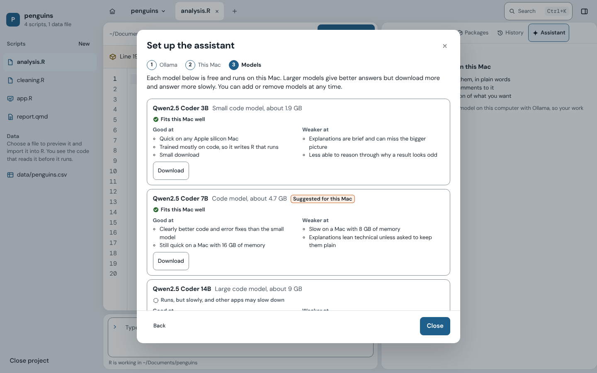
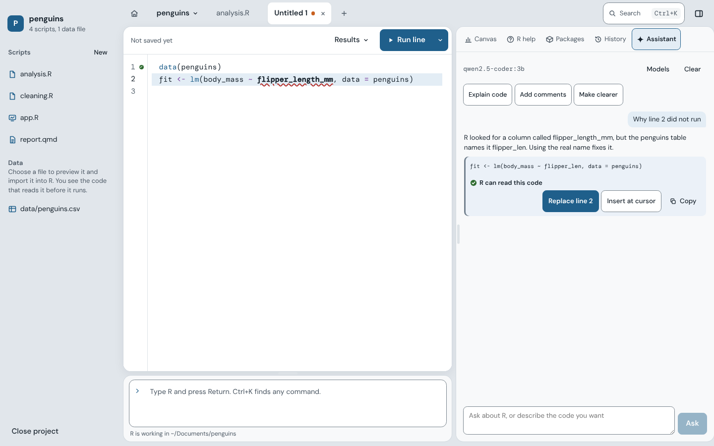

# Your files and your privacy

R: What Is It Good For? does not collect usage data, send crash reports, or upload your code or data anywhere. This page explains, in more detail, which files the app opens, what it keeps on your Mac, and what the optional assistant can see.

## Which files the app opens

The app only reads and writes scripts, meaning R, R Markdown, and Quarto files. It can open a script once you have chosen it in the Open or Save dialog, dropped it on the window, opened it from Finder, or picked it from the recent list. Opening a project, or a script inside one, also lets it open the other scripts in that project's folder, and nothing else.

To work out which project a script belongs to, the app looks at the folders above the script, stopping before your home folder, and checks only the file names for a `.Rproj` file. It does not read any file contents along the way.

The app never opens data files, whether they are listed in a project or chosen in Import Data. R reads them, for the preview and when the import code runs.

Help pages come from R itself. The app rebuilds them from a short list of allowed tags, so a help page cannot run code or reach the network.

The list of files the app may open is kept in the app's own core, not in the interface, and the interface cannot add to it. A file you never chose stays out of reach. The Open, Save, and project folder dialogs run in that same core.

## What the app keeps on your Mac

Settings, the lists of recent scripts and projects, and what to reopen at launch are kept in one file, `~/Library/Application Support/app.goodfor.ide/settings.json`. If that file gets damaged, the app sets it aside under a new name instead of deleting it.

As you type, unsaved changes are copied to the app's own storage on your computer so a crash cannot lose them. Each copy is deleted once its file is saved or closed. For Undo, R keeps references to your objects as they were before the last run, in memory only, until the next run. Timing a run writes R's samples to a temporary file, which R deletes when it quits.

The data viewer asks R for one page of rows at a time and keeps nothing once you close the tab. Exporting a plot reruns the code that made it in a scratch environment, so nothing it assigns ends up in your workspace, and it puts the random number state back afterward.

## When the app goes online

On its own, the app only goes online to check for updates. It asks GitHub, CRAN, and Ollama for the newest version numbers of the app, R, your packages, and Ollama, and sends nothing else. In Settings, under Updates, you can choose to check only when you ask. Nothing is installed until you press its button.

The optional assistant downloads Ollama and its models when you set it up, and after that it runs entirely on your Mac.

## What R itself can do

R itself can read and write anywhere your user account can, just as it does in Terminal or any other R environment. The app does not limit what your code does.

## The optional assistant

The assistant is optional. It stays off until you set it up from its button on the canvas, next to R help, Packages, and History. It runs through [Ollama](https://ollama.com), a free program that runs language models on your own computer.

Setting it up takes three steps.

1. Ollama. You can use the Ollama already on your Mac, or install a private copy inside the app. The private copy is Ollama 0.40.3, a 167 MB download. The app checks it against Ollama's published SHA-256 before unpacking it. It lives in `~/Library/Application Support/app.goodfor.ide/assistant`, runs only while the app is open, uses a port of its own, and can be removed, along with its models, from the same screen.
2. This Mac. If you agree, the app reads your Mac's memory, free disk space, and chip, so it can mark which models will fit. You can skip this step. Nothing is saved or sent.
3. Models. You choose from a short list of free code models: Qwen2.5 Coder in three sizes, and Qwen3 Coder. Each one says what it does well and less well when helping with R, how much it downloads, and whether it fits your Mac. The app suggests the largest one that fits comfortably. Models you already downloaded with Ollama are found and can be used, and you can add, remove, or switch models at any time.

<picture>
  <source media="(prefers-color-scheme: dark)" srcset="images/assistant-setup-dark.png">
  
</picture>

<picture>
  <source media="(prefers-color-scheme: dark)" srcset="images/assistant-dark.png">
  
</picture>

The assistant sees the code you ask about, R's error message, your R version, and the names of the objects in your session, including column names for tables. It never sees the values in your data.

Whatever it writes is a suggestion. Code only goes into your script when you press Insert or Replace. R's parser checks the code first without running it, and Undo takes it back out. Replace only appears when the suggestion is a reworked version of the code you asked about, so it can never wipe out your code with an unrelated step. If a suggestion only installs packages, you get Put in the Console instead, which places it at the R prompt. An install is a one-time step and does not belong in your script.
